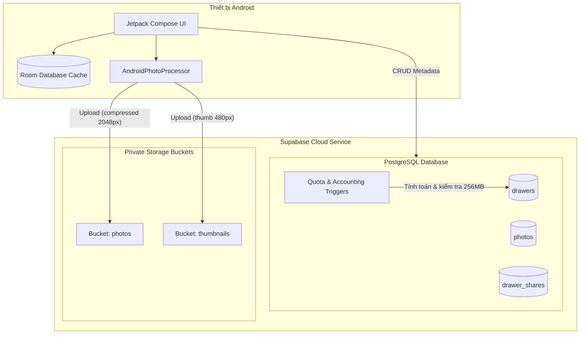

# TÀI LIỆU CHI TIẾT TÍNH NĂNG VÀ CƠ CHẾ LƯU TRỮ – FR-02: NGĂN KÉO KỶ NIỆM (MEMORY DRAWERS)

> **Loại tài liệu**: Tài liệu phân tích kỹ thuật & kiến trúc lưu trữ tạm thời  
> **Module liên quan**: FR-02 (Memory Drawers) – theo `docs/04-Plans/active/task-breakdown.md` và `docs/01-BA/SRS/01-fr.md`  
> **Dự án**: Pause Mobile App & Supabase Backend  

---

## MỤC LỤC
1. [Tổng quan FR-02 & Danh sách Task](#1-tổng-quan-fr-02--danh-sách-task)
2. [Chi tiết các chức năng nghiệp vụ (Functional Requirements)](#2-chi-tiết-các-chức-năng-nghiệp-vụ)
   - [FR-02.1: Danh sách ngăn kéo (Drawer List)](#fr-021-xem-danh-sách-ngăn-kéo)
   - [FR-02.2: Tạo ngăn kéo mới (Create Drawer)](#fr-022-tạo-ngăn-kéo-mới)
   - [FR-02.3: Chỉnh sửa ngăn kéo (Edit Drawer)](#fr-023-chỉnh-sửa-ngăn-kéo)
   - [FR-02.4: Xóa ngăn kéo (Delete Drawer)](#fr-024-xóa-ngăn-kéo)
   - [FR-02.5: Upload ảnh vào ngăn kéo (Photo Upload & Processing)](#fr-025-upload-ảnh-vào-ngăn-kéo)
   - [FR-02.6: Xem & Quản lý ảnh (Photo Viewer & Management)](#fr-026-xem--quản-lý-ảnh-trong-ngăn-kéo)
   - [FR-02.7: Chia sẻ ngăn kéo & Lời mời (Drawer Sharing & Invitations)](#fr-027-chia-sẻ-ngăn-kéo--lời-mời)
3. [Kiến trúc lưu trữ & Dữ liệu lưu trữ (Storage Architecture)](#3-kiến-trúc-lưu-trữ--dữ-liệu-lưu-trữ)
   - [Tầng 1: Supabase PostgreSQL (Database Schema & Accounting)](#31-tầng-cơ-sở-dữ-liệu-supabase-postgresql)
   - [Tầng 2: Supabase Storage Buckets (Object Storage)](#32-tầng-lưu-trữ-file-supabase-storage-buckets)
   - [Tầng 3: Client-side Offline Cache (Android Room DB & Memory Cache)](#33-tầng-lưu-trữ-cục-bộ-client-room-db--cache)
4. [Bảo mật & Phân quyền (Row Level Security - RLS)](#4-bảo-mật--phân-quyền-rls)
5. [Cơ chế xử lý ảnh & Tối ưu dung lượng](#5-cơ-chế-xử-lý-ảnh--tối-ưu-dung-lượng)

---

## 1. TỔNG QUAN FR-02 & DANH SÁCH TASK

Mục tiêu của **FR-02: Ngăn kéo Kỷ niệm (Memory Drawers)** là mang đến không gian lưu trữ và sắp xếp ảnh số an toàn, bảo mật, riêng tư cho người dùng với mô hình "Ngăn kéo kỷ niệm". Mỗi ngăn kéo đóng vai trò như một album hoặc chiếc hộp lưu giữ hình ảnh theo từng chủ đề/sự kiện, cho phép mời bạn bè cùng chia sẻ và đóng góp ảnh.

Dựa trên `task-breakdown.md`, FR-02 bao gồm **39 tasks**:
- **T-02.01 → T-02.06**: Backend / Supabase Setup (Bảng `drawers`, `photos`, `drawer_shares`, Bucket Storage `photos` & `thumbnails`, Edge Functions, Indexes).
- **T-02.07 → T-02.12**: Mobile Data Layer (`DrawerRepository`, `PhotoRepository`, `ShareRepository`, Room DB Cache, Batch Upload Service, Signed URL Helper).
- **T-02.13 → T-02.24**: Mobile Domain Layer (Domain models, 12 Use Cases về quản lý ngăn kéo, ảnh, lời mời chia sẻ).
- **T-02.25 → T-02.35**: Mobile Presentation Layer (Màn hình Compose: DrawerList, CreateDrawer, DrawerDetail, PhotoViewer, ShareDrawer, ShareInvitations, Storage Indicator, Upsell Dialog,...).
- **T-02.36 → T-02.39**: Kiểm thử Unit Tests & Integration Tests.

---

## 2. CHI TIẾT CÁC CHỨC NĂNG NGHIỆP VỤ

### FR-02.1: Xem danh sách ngăn kéo
- **Mô tả**: Hiển thị toàn bộ ngăn kéo mà người dùng có quyền truy cập, chia làm 2 nhóm:
  1. *Ngăn kéo của tôi (Owned Drawers)*: Do user làm chủ sở hữu (`owner_id = user_id`).
  2. *Được chia sẻ với tôi (Shared Drawers)*: Do người khác chia sẻ và đã được user **chấp nhận (`status = 'accepted'`)**.
- **Dữ liệu hiển thị**: Tên ngăn kéo, ảnh bìa (cover photo), số lượng ảnh, dung lượng đã sử dụng / dung lượng tối đa, nhãn quyền (`view` hoặc `edit`).
- **Badge lời mời**: Hiển thị số lượng lời mời chia sẻ đang chờ duyệt (`status = 'pending'`).

### FR-02.2: Tạo ngăn kéo mới
- **Điều kiện**: User chưa vượt quá hạn mức `max_drawers` trong bảng `profiles` (Mặc định Free Tier là **3 ngăn kéo**).
- **Validation**:
  - Tên ngăn kéo: 1 - 60 ký tự, không được chỉ chứa khoảng trắng.
  - Mô tả: Tối đa 300 ký tự.
  - Ảnh bìa: Tùy chọn (có thể chọn sau từ ảnh trong ngăn kéo).
- **Xử lý hạn mức (Quota Exceeded)**: Nếu user đạt giới hạn (3 ngăn kéo với tài khoản Free), trigger DB và Mobile App sẽ chặn lại và hiển thị **Upsell Prompt / Dialog** gợi ý nâng cấp gói Hội viên hoặc mua lẻ thêm ngăn kéo.

### FR-02.3: Chỉnh sửa ngăn kéo
- **Quyền hạn**: Chủ sở hữu (Owner) hoặc người được chia sẻ có quyền **`edit`**.
- **Các trường được phép cập nhật**: Tên (`name`), mô tả (`description`), ảnh bìa (`cover_photo_url`).
- **Quy tắc an toàn**: Server chặn việc user tự can thiệp sửa các trường hệ thống như `storage_used_bytes`, `storage_limit_bytes`, `owner_id`.

### FR-02.4: Xóa ngăn kéo
- **Quyền hạn**: **Chỉ duy nhất Chủ sở hữu (Owner)** mới có quyền xóa ngăn kéo.
- **Cơ chế xóa**:
  - **Cascade Database**: Xóa ngăn kéo trong bảng `drawers` sẽ tự động kích hoạt `ON DELETE CASCADE` xóa toàn bộ bản ghi `photos` và `drawer_shares` liên kết.
  - **Cleanup Storage**: Hệ thống tiến hành thu dọn và xóa các file ảnh gốc và thumbnail tương ứng trong Supabase Storage.
  - **Cảnh báo**: Hành động không thể khôi phục (vĩnh viễn).

### FR-02.5: Upload ảnh vào ngăn kéo
- **Quyền hạn**: Owner hoặc người được chia sẻ có quyền **`edit`** (và lời mời đã `accepted`).
- **Quy tắc & Kiểm tra Quota**:
  - Mỗi ngăn kéo có giới hạn: **256 MB** (Free tier).
  - Trước khi upload, app kiểm tra dung lượng còn lại: `remainingBytes = storage_limit_bytes - storage_used_bytes`.
  - Giới hạn kích thước mỗi file ảnh: Tối đa **5 MB**.
- **Xử lý Batch Upload**:
  - Hỗ trợ chọn nhiều ảnh cùng lúc từ thư viện thiết bị.
  - Nén ảnh và sinh thumbnail tự động trước khi đẩy lên mạng (tiết kiệm băng thông, giảm tải CPU server).
  - Có thanh hiển thị tiến trình (Progress Tracking) theo phần trăm từng ảnh và toàn bộ batch.

### FR-02.6: Xem & Quản lý ảnh trong ngăn kéo
- **Hiển thị Grid**: Danh sách ảnh sắp xếp giảm dần theo thời gian đăng tải (`uploaded_at DESC`), hỗ trợ phân trang (60 ảnh / trang).
- **Photo Viewer (Full-screen)**:
  - Xem ảnh phóng to, hỗ trợ cử chỉ vuốt ngang chuyển ảnh (HorizontalPager) và zoom 2 ngón (Pinch-to-zoom).
  - Xem metadata: Ngày chụp / upload, kích thước file, tác giả đăng ảnh.
- **Xóa ảnh (Delete Photos)**:
  - Hỗ trợ chế độ chọn nhiều ảnh (Multi-select) để xóa hàng loạt.
  - Quyền xóa: Owner ngăn kéo có quyền xóa mọi ảnh; Người đóng góp (Edit) chỉ xóa được ảnh do chính mình upload (`uploaded_by = auth.uid()`).
  - Hoàn trả dung lượng: Kích hoạt trigger trừ lùi dung lượng `storage_used_bytes` của ngăn kéo tương ứng.

### FR-02.7: Chia sẻ ngăn kéo & Lời mời
- **Luồng mời hai bước (Two-step Invitation)**:
  1. Owner nhập email người muốn mời và phân quyền:
     - `view`: Chỉ xem ảnh, không thể upload hay xóa.
     - `edit`: Xem + Upload ảnh + sửa thông tin ngăn kéo.
  2. Tạo bản ghi chia sẻ ở trạng thái **`pending`**.
  3. Người nhận mở app, xem danh sách lời mời chờ duyệt:
     - **Chấp nhận (`accepted`)**: Ngăn kéo xuất hiện trong danh sách ngăn kéo chia sẻ của họ; RLS mở quyền truy cập DB và Storage.
     - **Từ chối (`rejected`)**: Lời mời bị hủy, không kích hoạt quyền truy cập.
- **Thu hồi quyền (Revoke)**: Owner có thể xóa lời mời pending hoặc hủy quyền của người đã chia sẻ bất kỳ lúc nào. Người được chia sẻ cũng có thể tự rời khỏi ngăn kéo (`DELETE FROM drawer_shares`).

---

## 3. KIẾN TRÚC LƯU TRỮ & DỮ LIỆU LƯU TRỮ

Hệ thống lưu trữ của FR-02 phân bổ theo mô hình 3 tầng (3-tier storage architecture):



---

### 3.1. Tầng Cơ sở dữ liệu (Supabase PostgreSQL)

#### Bảng `drawers` (Lưu thông tin ngăn kéo)
| Tên cột | Kiểu dữ liệu | Ràng buộc | Mô tả |
|---|---|---|---|
| `id` | `UUID` | PK, DEFAULT `gen_random_uuid()` | Khóa chính của ngăn kéo |
| `owner_id` | `UUID` | FK -> `profiles(id)` ON DELETE CASCADE | ID chủ sở hữu |
| `name` | `TEXT` | NOT NULL, 1 - 60 chars | Tên ngăn kéo |
| `description` | `TEXT` | NULLABLE, <= 300 chars | Mô tả ngắn |
| `cover_photo_url` | `TEXT` | NULLABLE | Đường dẫn object path ảnh bìa |
| `storage_used_bytes` | `BIGINT` | NOT NULL DEFAULT 0 | Tổng dung lượng ảnh hiện tại (bytes) |
| `storage_limit_bytes` | `BIGINT` | NOT NULL DEFAULT 268435456 | Hạn mức dung lượng (256 MB cho Free) |
| `is_purchased` | `BOOLEAN` | NOT NULL DEFAULT FALSE | True nếu là ngăn kéo mua lẻ |
| `created_at` | `TIMESTAMPTZ` | NOT NULL DEFAULT NOW() | Thời điểm tạo |
| `updated_at` | `TIMESTAMPTZ` | NOT NULL DEFAULT NOW() | Thời điểm sửa đổi gần nhất |

#### Bảng `photos` (Lưu metadata của ảnh)
| Tên cột | Kiểu dữ liệu | Ràng buộc | Mô tả |
|---|---|---|---|
| `id` | `UUID` | PK, DEFAULT `gen_random_uuid()` | Khóa chính của ảnh |
| `drawer_id` | `UUID` | FK -> `drawers(id)` ON DELETE CASCADE | Ngăn kéo chứa ảnh |
| `uploaded_by` | `UUID` | FK -> `profiles(id)` | Người đăng tải |
| `original_url` | `TEXT` | NOT NULL | **Object path** trong bucket `photos` |
| `thumbnail_url` | `TEXT` | NULLABLE | **Object path** trong bucket `thumbnails` |
| `file_size_bytes` | `BIGINT` | NOT NULL, CHECK <= 5 MB | Dung lượng thực tế sau khi nén |
| `mime_type` | `TEXT` | NOT NULL DEFAULT 'image/jpeg' | Định dạng file (image/jpeg, webp, png) |
| `width` | `INTEGER` | NULLABLE | Chiều rộng ảnh (pixels) |
| `height` | `INTEGER` | NULLABLE | Chiều cao ảnh (pixels) |
| `taken_at` | `TIMESTAMPTZ` | NULLABLE | Ngày chụp từ metadata EXIF (nếu có) |
| `uploaded_at` | `TIMESTAMPTZ` | NOT NULL DEFAULT NOW() | Ngày giờ upload |

#### Bảng `drawer_shares` (Lưu phân quyền & Lời mời chia sẻ)
| Tên cột | Kiểu dữ liệu | Ràng buộc | Mô tả |
|---|---|---|---|
| `id` | `UUID` | PK, DEFAULT `gen_random_uuid()` | Khóa chính bản ghi chia sẻ |
| `drawer_id` | `UUID` | FK -> `drawers(id)` ON DELETE CASCADE | Ngăn kéo được chia sẻ |
| `owner_id` | `UUID` | FK -> `profiles(id)` | Người chia sẻ (Owner) |
| `shared_with_id`| `UUID` | FK -> `profiles(id)` | Người nhận lời mời |
| `permission` | `TEXT` | NOT NULL CHECK IN (`'view'`, `'edit'`) | Quyền hạn cấp cho người nhận |
| `status` | `TEXT` | NOT NULL DEFAULT `'pending'` | Trạng thái: `pending`, `accepted`, `rejected` |
| `created_at` | `TIMESTAMPTZ` | NOT NULL DEFAULT NOW() | Thời điểm gửi lời mời |
| `responded_at` | `TIMESTAMPTZ` | NULLABLE | Thời điểm chấp nhận / từ chối |
| *(Unique)* | `UNIQUE(drawer_id, shared_with_id)` | | 1 user chỉ có 1 lời mời duy nhất / ngăn kéo |

---

### 3.2. Tầng Lưu trữ File (Supabase Storage Buckets)

Hệ thống sử dụng **2 Private Storage Buckets** để bảo vệ dữ liệu người dùng:

1. **Bucket `photos` (Private)**:
   - Lưu ảnh gốc đã qua tối ưu hoá (Max 2048px, JPEG quality 82).
   - Quy ước cấu trúc đường dẫn (Object Path):
     ```
     photos/{drawer_id}/{photo_id}.jpg
     ```
   - *Lưu ý quan trọng*: Đường dẫn tổ chức theo `{drawer_id}` (thay vì `{user_id}`) để cả người sở hữu lẫn người được chia sẻ quyền `edit` đều có thể ghi và đọc dữ liệu theo chính sách RLS ngăn kéo.
2. **Bucket `thumbnails` (Private)**:
   - Lưu ảnh thu nhỏ dạng thumbnail phục vụ hiển thị grid và danh sách (Max 480px, JPEG quality 70).
   - Quy ước cấu trúc đường dẫn (Object Path):
     ```
     thumbnails/{drawer_id}/{photo_id}_thumb.jpg
     ```
3. **Cơ chế truy cập URL tạm thời (Signed URLs)**:
   - Các file trong bucket là private hoàn toàn, không có public URL trực tiếp.
   - Khi client cần hiển thị ảnh, mobile app gọi helper tạo **Signed URL** có thời hạn (TTL 55 phút).
   - Cache in-memory trên mobile giúp tái sử dụng Signed URL mà không cần query lại server mỗi lần render UI.

---

### 3.3. Tầng Lưu trữ Cục bộ Client (Room DB & Cache)

Trên thiết bị Android của người dùng, ứng dụng tích hợp **Room Database (`PauseDatabase`)** đóng vai trò cache offline theo mô hình Read-through Cache:

1. **`DrawerEntity`**: Cache danh sách ngăn kéo, số lượng ảnh, dung lượng, quyền sở hữu.
2. **`PhotoEntity`**: Cache danh sách metadata ảnh theo `drawer_id`.
3. **`ShareEntity`**: Cache danh sách thành viên chia sẻ và lời mời.
4. **Offline Fallback**: Khi thiết bị mất kết nối mạng, người dùng vẫn có thể xem lại cấu trúc ngăn kéo, danh sách ảnh đã cache và thumbnail đã lưu trong bộ nhớ đệm hình ảnh (Coil disk cache).

---

## 4. BẢO MẬT & PHÂN QUYỀN (RLS)

Hệ thống kích hoạt Row Level Security (RLS) trên toàn bộ các bảng để đảm bảo kiểm soát truy cập trực tiếp từ tầng cơ sở dữ liệu:

- **Bảng `drawers`**:
  - `SELECT`: Chủ sở hữu (`owner_id = auth.uid()`) **HOẶC** người được chia sẻ có `status = 'accepted'` trong `drawer_shares`.
  - `INSERT`: Chỉ user xác thực và `owner_id = auth.uid()`.
  - `UPDATE`: Owner sửa toàn bộ; Người có quyền `edit` chỉ được sửa thông qua RPC hoặc chính sách giới hạn cột.
  - `DELETE`: **Chỉ chủ sở hữu (`owner_id = auth.uid()`)**.
- **Bảng `photos`**:
  - `SELECT`: Thuộc ngăn kéo mà user là Owner hoặc có share `accepted`.
  - `INSERT`: Owner ngăn kéo **HOẶC** user có quyền `permission = 'edit'` và `status = 'accepted'`.
  - `DELETE`: Chủ sở hữu ngăn kéo **HOẶC** người đã trực tiếp upload bức ảnh đó (`uploaded_by = auth.uid()`).
- **Bảng `drawer_shares`**:
  - `SELECT`: Owner ngăn kéo xem danh sách đã mời; Người nhận (`shared_with_id = auth.uid()`) xem các lời mời gửi đến mình.
  - `INSERT`: Chỉ Owner của ngăn kéo mới được tạo lời mời chia sẻ.
  - `UPDATE`: **Chỉ người nhận (`shared_with_id = auth.uid()`)** được phép cập nhật chuyển `status` từ `pending` sang `accepted` hoặc `rejected`.
  - `DELETE`: Owner có thể hủy chia sẻ; Người nhận có thể xóa bản ghi để tự rời khỏi ngăn kéo.

---

## 5. CƠ CHẾ XỬ LÝ ẢNH & TỐI ƯU DUNG LƯỢNG

1. **Client-Side Compression (`AndroidPhotoProcessor`)**:
   - Khi user chọn ảnh từ thư viện (thường 5 - 15 MB mỗi ảnh):
     - Đọc thông số hướng xoay EXIF để tự xoay ảnh đúng chiều.
     - **Ảnh chính**: Downscale chiều dài nhất về tối đa **2048 px**, nén JPEG ở mức Quality 82. Kích thước file giảm xuống trung bình còn **300 KB – 800 KB**.
     - **Ảnh Thumbnail**: Downscale chiều dài nhất về tối đa **480 px**, nén JPEG ở mức Quality 70. Kích thước thumbnail chỉ khoảng **20 KB – 50 KB**.
   - *Lợi ích*: Giảm 90% băng thông tải lên, tăng tốc độ trải nghiệm và không gây tốn tài nguyên server.
2. **Server-Side Accounting & Safeguard (PostgreSQL Triggers)**:
   - **Trigger `enforce_photo_quota`**: Thực thi `BEFORE INSERT` trên bảng `photos`. Tính năng khóa dòng (`FOR UPDATE`) ngăn ngừa tình trạng race condition khi nhiều thiết bị cùng upload một lúc. Nếu `storage_used_bytes + file_size_bytes > storage_limit_bytes`, giao dịch bị từ chối ngay tại DB.
   - **Trigger `release_photo_storage`**: Thực thi `AFTER DELETE` trên bảng `photos` để trừ lùi dung lượng đã giải phóng khỏi ngăn kéo.
