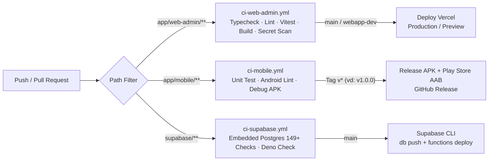

# Hướng dẫn CI/CD – Pause (Mobile, Web Admin & Supabase)

> Tài liệu mô tả toàn bộ pipeline **Continuous Integration / Continuous Deployment (CI/CD)** sử dụng **GitHub Actions** cho monorepo Pause.

---

## 1. Kiến trúc tổng quan



Mỗi workflow có **path filter** riêng và bật `concurrency.cancel-in-progress: true`:
- Sửa code Mobile không làm chạy lại CI của Web và ngược lại.
- Push liên tiếp trên cùng một nhánh tự động hủy job cũ đang chạy dở để tiết kiệm phút CI.

---

## 2. Chi tiết 3 Workflows

| Workflow | File | Kích hoạt khi | CI (Kiểm tra) | CD (Triển khai) |
|---|---|---|---|---|
| **Web Admin** | [.github/workflows/ci-web-admin.yml](../../.github/workflows/ci-web-admin.yml) | Push / PR `main`, `webapp-dev` (`app/web-admin/**`) | `npm ci`, `typecheck`, `lint`, `vitest`, `next build`, quét `.next/static` chống lộ secret | Deploy tự động lên **Vercel** (`main` → Production, `webapp-dev` → Preview) nếu có secrets |
| **Mobile Android** | [.github/workflows/ci-mobile.yml](../../.github/workflows/ci-mobile.yml) | Push / PR `main`, `mobile-app_dev`, tag `v*` (`app/mobile/**`) | JDK 17, `testDebugUnitTest`, `lintDebug`, `assembleDebug` + tải artifact `app-debug.apk` | Khi push tag `v*` (hoặc chạy tay `build_release=true`): build Release `.apk` & `.aab` (ký bằng keystore nếu có) và đăng lên **GitHub Releases** để upload lên Play Store |
| **Supabase Backend** | [.github/workflows/ci-supabase.yml](../../.github/workflows/ci-supabase.yml) | Push / PR `main`, `webapp-dev`, `mobile-app_dev` (`supabase/**`) | Chạy `validate_migrations.py` trên PostgreSQL thật + `deno check` toàn bộ Edge Functions | Khi merge vào `main`: tự chạy `supabase db push` và `supabase functions deploy` (nếu có secrets) |

---

## 3. Cấu hình GitHub Secrets

Vào **GitHub Repository → Settings → Secrets and variables → Actions → New repository secret**.

### 3.1 Cho Web Admin (`ci-web-admin.yml`)

| Secret | Bắt buộc? | Mô tả |
|---|---|---|
| `NEXT_PUBLIC_SUPABASE_URL` | Nên có | URL Supabase Project (dùng lúc `next build`) |
| `NEXT_PUBLIC_SUPABASE_ANON_KEY` | Nên có | Anon key Supabase |
| `VERCEL_TOKEN` | Tùy chọn* | Token lấy tại Vercel → Account Settings → Tokens |
| `VERCEL_ORG_ID` | Tùy chọn* | Org ID trong `.vercel/project.json` sau khi chạy `vercel link` |
| `VERCEL_PROJECT_ID` | Tùy chọn* | Project ID trong `.vercel/project.json` |

> *Nếu bạn kết nối repo trực tiếp với **Vercel GitHub App** (Root Directory = `app/web-admin`), có thể bỏ trống 3 secret Vercel — job `deploy-vercel` sẽ tự động bỏ qua mà không báo lỗi. Nhớ cấu hình đầy đủ biến server-only (`SUPABASE_SERVICE_ROLE_KEY`, `CLOUDINARY_*`, `USE_MOCK_ADMIN_DATA=false`) trong **Vercel Project Settings → Environment Variables**.

### 3.2 Cho Mobile Android (`ci-mobile.yml`)

| Secret | Bắt buộc? | Mô tả |
|---|---|---|
| `SUPABASE_URL`, `SUPABASE_ANON_KEY` | Khi build APK thật | Biến BuildConfig cho app Mobile |
| `GOOGLE_WEB_CLIENT_ID` | Tùy chọn | OAuth Client ID cho Google Sign-In |
| `CLOUDINARY_CLOUD_NAME`, `CLOUDINARY_UPLOAD_PRESET` | Khi build APK thật | Cấu hình upload ảnh ngăn kéo |
| `PAYOS_CLIENT_ID`, `PAYOS_API_KEY`, `PAYOS_CHECKSUM_KEY` | Tùy chọn | Cấu hình PayOS |
| `GOOGLE_SERVICES_JSON_BASE64` | Tùy chọn (FCM) | Nội dung file `google-services.json` mã hóa Base64 |
| `ANDROID_KEYSTORE_BASE64` | Khi release Play Store | File `.jks` keystore ký release mã hóa Base64 |
| `ANDROID_KEYSTORE_PASSWORD` | Khi release Play Store | Mật khẩu keystore |
| `ANDROID_KEY_ALIAS` | Khi release Play Store | Alias của key trong keystore |
| `ANDROID_KEY_PASSWORD` | Khi release Play Store | Mật khẩu của key |

Cách mã hóa file sang Base64 trên PowerShell (Windows):
```powershell
[Convert]::ToBase64String([IO.File]::ReadAllBytes("path\to\release-keystore.jks")) | Set-Clipboard
```

### 3.3 Cho Supabase (`ci-supabase.yml`)

| Secret | Bắt buộc? | Mô tả |
|---|---|---|
| `SUPABASE_ACCESS_TOKEN` | Khi bật auto-deploy | Personal Access Token từ Supabase Account → Access Tokens |
| `SUPABASE_PROJECT_ID` | Khi bật auto-deploy | Project ref (ví dụ `bgpwlbpcfcjjtvuzaxyt`) |
| `SUPABASE_DB_PASSWORD` | Khi bật auto-deploy | Database password của Supabase project |

---

## 4. Quy trình phát hành (Release Workflow)

### 4.1 Phát hành Web Admin (Vercel)
1. Phát triển trên nhánh `webapp-dev` → push lên GitHub → `ci-web-admin.yml` tự kiểm tra và tạo bản **Preview** (nếu đã cấu hình Vercel).
2. Tạo Pull Request từ `webapp-dev` → `main` → đợi tất cả CI checks xanh → Merge.
3. Khi merge vào `main`, Web Admin tự động deploy lên **Production** (region `sin1` Singapore, đặt trong [vercel.json](../../app/web-admin/vercel.json)).

### 4.2 Phát hành Mobile Android (APK / Play Store AAB)
1. Phát triển trên nhánh `mobile-app_dev` → mỗi lần push, CI tự chạy unit test + lint và đính kèm file `pause-android-debug-apk` trong tab **Actions → Artifacts** để tester cài thử ngay.
2. Khi chốt phiên bản phát hành:
   - Tăng `versionCode` và `versionName` trong `app/mobile/app/build.gradle.kts`, merge vào `main`.
   - Tạo và đẩy tag phiên bản:
     ```bash
     git tag v1.0.0
     git push origin v1.0.0
     ```
   - GitHub Actions tự động build **Release APK & AAB** (đã ký bằng keystore) và đăng lên mục **GitHub Releases**.
   - Tải file `.aab` từ GitHub Release và upload lên **Google Play Console** (theo chính sách phát hành thủ công trong `AGENTS.md`).

---

## 5. Khuyến nghị Branch Protection trên GitHub

Vào **Settings → Branches → Add branch protection rule** cho `main`:
- Bật **Require a pull request before merging** (không push trực tiếp lên `main`).
- Bật **Require status checks to pass before merging**, chọn:
  - `Typecheck, Lint, Test & Build` (Web Admin)
  - `Unit Tests, Lint & Debug APK` (Mobile)
  - `Validate SQL Migrations (Embedded Postgres)` & `Typecheck Supabase Edge Functions (Deno)` (Supabase)
