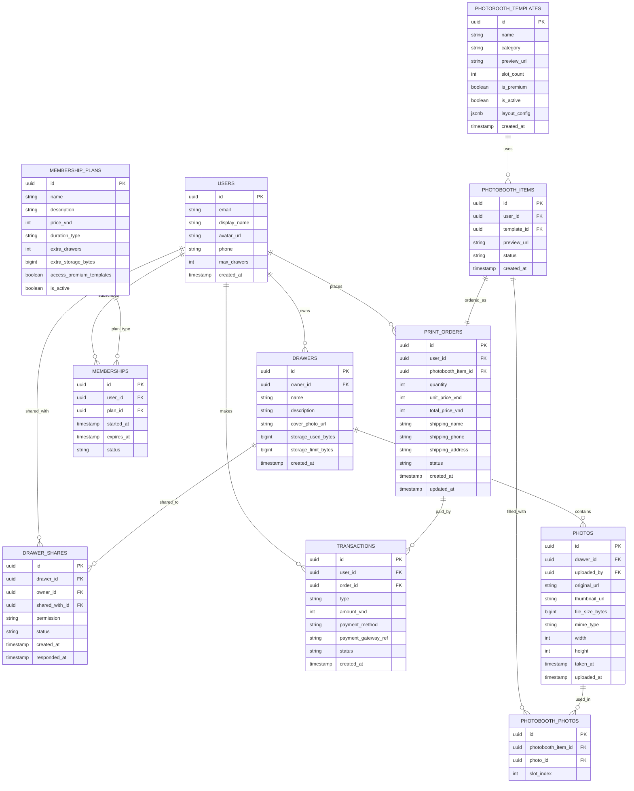

# Database Schema – Supabase PostgreSQL

> Schema cho hệ thống Pause – sử dụng Supabase (PostgreSQL) với Row Level Security (RLS).

---

## Entity Relationship Diagram



---

## Chi tiết bảng (Table Definitions)

### 1. `users` (mở rộng từ `auth.users`)

> Supabase Auth đã tạo bảng `auth.users`. Bảng `public.profiles` mở rộng thêm thông tin.

```sql
CREATE TABLE public.profiles (
    id UUID PRIMARY KEY REFERENCES auth.users(id) ON DELETE CASCADE,
    display_name TEXT NOT NULL,
    avatar_url TEXT,
    phone TEXT,
    max_drawers INTEGER NOT NULL DEFAULT 3,  -- Free tier: 3
    created_at TIMESTAMPTZ NOT NULL DEFAULT NOW(),
    updated_at TIMESTAMPTZ NOT NULL DEFAULT NOW()
);

-- Trigger tự động tạo profile khi user đăng ký
CREATE OR REPLACE FUNCTION public.handle_new_user()
RETURNS TRIGGER AS $$
BEGIN
    INSERT INTO public.profiles (id, display_name)
    VALUES (NEW.id, COALESCE(NEW.raw_user_meta_data->>'display_name', NEW.email));
    RETURN NEW;
END;
$$ LANGUAGE plpgsql SECURITY DEFINER;

CREATE TRIGGER on_auth_user_created
    AFTER INSERT ON auth.users
    FOR EACH ROW EXECUTE FUNCTION public.handle_new_user();
```

**RLS Policies:**
```sql
ALTER TABLE public.profiles ENABLE ROW LEVEL SECURITY;

CREATE POLICY "Users can view own profile"
    ON profiles FOR SELECT USING (auth.uid() = id);

CREATE POLICY "Users can update own profile"
    ON profiles FOR UPDATE USING (auth.uid() = id);
```

> **Đã triển khai** – toàn bộ schema nằm trong một file baseline duy nhất:
> `supabase/migrations/20251115090000_init_schema.sql`.
> - `profiles` chỉ cấp `SELECT/UPDATE` cho role `authenticated`; `INSERT/DELETE`
>   do trigger `handle_new_user()` (SECURITY DEFINER) và `ON DELETE CASCADE` xử lý.
> - Trigger `protect_profiles_columns()` chặn user tự đổi `max_drawers`
>   (chỉ `service_role` được đổi – dùng cho gói hội viên/mua lẻ).
> - **Đã bỏ** trigger `on_profile_created_create_default_drawers` (migration
>   `20251114090000_fr02_repair.sql`): trước đây nó tạo sẵn 3 ngăn kéo trống và
>   chiếm hết quota free tier khiến tài khoản mới không tạo thêm được ngăn kéo.
>   Hiện `max_drawers` chỉ là hạn mức, ngăn kéo được tạo theo nhu cầu.
> - Trigger `enforce_drawer_quota()` chặn tạo ngăn kéo vượt `max_drawers` ở tầng DB.
> - Trigger `handle_user_metadata_update()` đồng bộ `display_name` từ metadata
>   Google/OAuth cho user chưa đặt tên.

---

### 2. `drawers` (Ngăn kéo kỷ niệm)

```sql
CREATE TABLE public.drawers (
    id UUID PRIMARY KEY DEFAULT gen_random_uuid(),
    owner_id UUID NOT NULL REFERENCES public.profiles(id) ON DELETE CASCADE,
    name TEXT NOT NULL,
    description TEXT,
    cover_photo_url TEXT,
    storage_used_bytes BIGINT NOT NULL DEFAULT 0,
    storage_limit_bytes BIGINT NOT NULL DEFAULT 268435456,  -- 256 MB (free tier)
    is_purchased BOOLEAN NOT NULL DEFAULT FALSE,  -- true nếu mua lẻ
    created_at TIMESTAMPTZ NOT NULL DEFAULT NOW(),
    updated_at TIMESTAMPTZ NOT NULL DEFAULT NOW()
);

CREATE INDEX idx_drawers_owner ON drawers(owner_id);
```

**RLS Policies:**
```sql
ALTER TABLE public.drawers ENABLE ROW LEVEL SECURITY;

-- Owner xem ngăn kéo của mình
CREATE POLICY "Owners can view own drawers"
    ON drawers FOR SELECT
    USING (owner_id = auth.uid());

-- Người được chia sẻ xem ngăn kéo (chỉ khi đã chấp nhận lời mời)
CREATE POLICY "Shared users can view drawers"
    ON drawers FOR SELECT
    USING (
        id IN (
            SELECT drawer_id FROM drawer_shares
            WHERE shared_with_id = auth.uid() AND status = 'accepted'
        )
    );

-- Owner CRUD
CREATE POLICY "Owners can insert drawers"
    ON drawers FOR INSERT
    WITH CHECK (owner_id = auth.uid());

-- Owner CRUD
CREATE POLICY "Owners can update own drawers"
    ON drawers FOR UPDATE
    USING (owner_id = auth.uid());

CREATE POLICY "Owners can delete own drawers"
    ON drawers FOR DELETE
    USING (owner_id = auth.uid());
```

---

### 3. `photos` (Ảnh trong ngăn kéo)

```sql
CREATE TABLE public.photos (
    id UUID PRIMARY KEY DEFAULT gen_random_uuid(),
    drawer_id UUID NOT NULL REFERENCES public.drawers(id) ON DELETE CASCADE,
    uploaded_by UUID NOT NULL REFERENCES public.profiles(id),
    original_url TEXT NOT NULL,
    thumbnail_url TEXT,
    file_size_bytes BIGINT NOT NULL,
    mime_type TEXT NOT NULL DEFAULT 'image/jpeg',
    width INTEGER,
    height INTEGER,
    taken_at TIMESTAMPTZ,           -- EXIF date nếu có
    uploaded_at TIMESTAMPTZ NOT NULL DEFAULT NOW()
);

CREATE INDEX idx_photos_drawer ON photos(drawer_id);
CREATE INDEX idx_photos_uploaded_by ON photos(uploaded_by);
```

**RLS Policies:**
```sql
ALTER TABLE public.photos ENABLE ROW LEVEL SECURITY;

-- Xem ảnh: owner ngăn kéo hoặc người được chia sẻ đã chấp nhận lời mời
CREATE POLICY "Can view photos in accessible drawers"
    ON photos FOR SELECT
    USING (
        drawer_id IN (
            SELECT id FROM drawers WHERE owner_id = auth.uid()
            UNION
            SELECT drawer_id FROM drawer_shares
            WHERE shared_with_id = auth.uid() AND status = 'accepted'
        )
    );

-- Upload ảnh: owner hoặc người có quyền Edit đã chấp nhận lời mời
CREATE POLICY "Can insert photos with edit permission"
    ON photos FOR INSERT
    WITH CHECK (
        drawer_id IN (
            SELECT id FROM drawers WHERE owner_id = auth.uid()
            UNION
            SELECT drawer_id FROM drawer_shares
            WHERE shared_with_id = auth.uid() AND permission = 'edit' AND status = 'accepted'
        )
    );

-- Xóa ảnh: chỉ owner ngăn kéo hoặc người upload ảnh đó
CREATE POLICY "Can delete own photos or as drawer owner"
    ON photos FOR DELETE
    USING (
        uploaded_by = auth.uid()
        OR drawer_id IN (SELECT id FROM drawers WHERE owner_id = auth.uid())
    );
```

---

### 4. `drawer_shares` (Chia sẻ ngăn kéo)

```sql
CREATE TABLE public.drawer_shares (
    id UUID PRIMARY KEY DEFAULT gen_random_uuid(),
    drawer_id UUID NOT NULL REFERENCES public.drawers(id) ON DELETE CASCADE,
    owner_id UUID NOT NULL REFERENCES public.profiles(id),
    shared_with_id UUID NOT NULL REFERENCES public.profiles(id),
    permission TEXT NOT NULL CHECK (permission IN ('view', 'edit')),
    status TEXT NOT NULL DEFAULT 'pending' CHECK (status IN ('pending', 'accepted', 'rejected')),
    created_at TIMESTAMPTZ NOT NULL DEFAULT NOW(),
    responded_at TIMESTAMPTZ,

    UNIQUE(drawer_id, shared_with_id)  -- Mỗi user chỉ được mời 1 lần / ngăn kéo
);

CREATE INDEX idx_shares_shared_with ON drawer_shares(shared_with_id);
CREATE INDEX idx_shares_drawer ON drawer_shares(drawer_id);
CREATE INDEX idx_shares_status ON drawer_shares(shared_with_id, status);
```

**RLS Policies:**
```sql
ALTER TABLE public.drawer_shares ENABLE ROW LEVEL SECURITY;

-- Owner xem danh sách chia sẻ của ngăn kéo mình
CREATE POLICY "Owners can view shares of own drawers"
    ON drawer_shares FOR SELECT
    USING (owner_id = auth.uid());

-- Người nhận xem các lời mời gửi đến mình
CREATE POLICY "Shared users can view received shares"
    ON drawer_shares FOR SELECT
    USING (shared_with_id = auth.uid());

-- Owner gửi lời mời chia sẻ (mặc định pending)
CREATE POLICY "Owners can insert shares"
    ON drawer_shares FOR INSERT
    WITH CHECK (owner_id = auth.uid());

-- Người nhận phản hồi lời mời (Chấp nhận / Từ chối)
CREATE POLICY "Shared users can respond to invitations"
    ON drawer_shares FOR UPDATE
    USING (shared_with_id = auth.uid())
    WITH CHECK (shared_with_id = auth.uid());

-- Owner thu hồi lời mời/quyền chia sẻ, hoặc người nhận tự rời ngăn kéo
CREATE POLICY "Owners or shared users can delete shares"
    ON drawer_shares FOR DELETE
    USING (owner_id = auth.uid() OR shared_with_id = auth.uid());
```

---

### 5. `photobooth_templates` (Mẫu Photobooth)

```sql
CREATE TABLE public.photobooth_templates (
    id UUID PRIMARY KEY DEFAULT gen_random_uuid(),
    name TEXT NOT NULL,
    category TEXT NOT NULL DEFAULT 'general',  -- 'couple', 'friends', 'family', 'general'
    preview_url TEXT NOT NULL,
    slot_count INTEGER NOT NULL CHECK (slot_count > 0),
    is_premium BOOLEAN NOT NULL DEFAULT FALSE,
    is_active BOOLEAN NOT NULL DEFAULT TRUE,
    layout_config JSONB NOT NULL,  -- Cấu hình vị trí slot, kích thước, text
    created_at TIMESTAMPTZ NOT NULL DEFAULT NOW(),
    updated_at TIMESTAMPTZ NOT NULL DEFAULT NOW()
);
```

**Ví dụ `layout_config`:**
```json
{
  "width": 1200,
  "height": 1800,
  "background_color": "#FFFFFF",
  "slots": [
    { "index": 0, "x": 50, "y": 50, "width": 500, "height": 375 },
    { "index": 1, "x": 650, "y": 50, "width": 500, "height": 375 },
    { "index": 2, "x": 50, "y": 475, "width": 500, "height": 375 },
    { "index": 3, "x": 650, "y": 475, "width": 500, "height": 375 }
  ],
  "texts": [
    { "content": "Pause ❤️", "x": 500, "y": 900, "font_size": 24, "color": "#333" }
  ],
  "frame_url": "https://storage.../frames/classic-white.png"
}
```

---

### 6. `photobooth_items` (Photobooth đã tạo)

```sql
CREATE TABLE public.photobooth_items (
    id UUID PRIMARY KEY DEFAULT gen_random_uuid(),
    user_id UUID NOT NULL REFERENCES public.profiles(id) ON DELETE CASCADE,
    template_id UUID NOT NULL REFERENCES public.photobooth_templates(id),
    preview_url TEXT,               -- URL ảnh preview đã render
    status TEXT NOT NULL DEFAULT 'draft' CHECK (status IN ('draft', 'completed', 'ordered')),
    created_at TIMESTAMPTZ NOT NULL DEFAULT NOW()
);
```

### 7. `photobooth_photos` (Ảnh fill vào photobooth)

```sql
CREATE TABLE public.photobooth_photos (
    id UUID PRIMARY KEY DEFAULT gen_random_uuid(),
    photobooth_item_id UUID NOT NULL REFERENCES public.photobooth_items(id) ON DELETE CASCADE,
    photo_id UUID NOT NULL REFERENCES public.photos(id),
    slot_index INTEGER NOT NULL,

    UNIQUE(photobooth_item_id, slot_index)  -- Mỗi slot chỉ 1 ảnh
);
```

---

### 8. `membership_plans` (Cấu hình gói hội viên)

```sql
CREATE TABLE public.membership_plans (
    id UUID PRIMARY KEY DEFAULT gen_random_uuid(),
    name TEXT NOT NULL,                            -- 'Basic', 'Premium'
    description TEXT,
    price_vnd INTEGER NOT NULL,                    -- Giá VND
    duration_type TEXT NOT NULL CHECK (duration_type IN ('monthly', 'yearly')),
    extra_drawers INTEGER NOT NULL DEFAULT 0,      -- Số ngăn kéo thêm
    extra_storage_bytes BIGINT NOT NULL DEFAULT 0, -- Dung lượng thêm / ngăn kéo
    access_premium_templates BOOLEAN NOT NULL DEFAULT FALSE,
    is_active BOOLEAN NOT NULL DEFAULT TRUE,
    created_at TIMESTAMPTZ NOT NULL DEFAULT NOW()
);
```

### 9. `memberships` (Đăng ký hội viên của user)

```sql
CREATE TABLE public.memberships (
    id UUID PRIMARY KEY DEFAULT gen_random_uuid(),
    user_id UUID NOT NULL REFERENCES public.profiles(id) ON DELETE CASCADE,
    plan_id UUID NOT NULL REFERENCES public.membership_plans(id),
    started_at TIMESTAMPTZ NOT NULL DEFAULT NOW(),
    expires_at TIMESTAMPTZ NOT NULL,
    status TEXT NOT NULL DEFAULT 'active' CHECK (status IN ('active', 'expired', 'cancelled')),
    created_at TIMESTAMPTZ NOT NULL DEFAULT NOW()
);

CREATE INDEX idx_memberships_user ON memberships(user_id);
CREATE INDEX idx_memberships_status ON memberships(status);
```

---

### 10. `print_orders` (Đơn hàng in ấn)

```sql
CREATE TABLE public.print_orders (
    id UUID PRIMARY KEY DEFAULT gen_random_uuid(),
    user_id UUID NOT NULL REFERENCES public.profiles(id),
    photobooth_item_id UUID NOT NULL REFERENCES public.photobooth_items(id),
    quantity INTEGER NOT NULL DEFAULT 1 CHECK (quantity > 0),
    unit_price_vnd INTEGER NOT NULL,
    total_price_vnd INTEGER NOT NULL,
    shipping_name TEXT NOT NULL,
    shipping_phone TEXT NOT NULL,
    shipping_address TEXT NOT NULL,
    status TEXT NOT NULL DEFAULT 'pending'
        CHECK (status IN ('pending', 'processing', 'printing', 'shipping', 'completed', 'cancelled')),
    admin_notes TEXT,
    created_at TIMESTAMPTZ NOT NULL DEFAULT NOW(),
    updated_at TIMESTAMPTZ NOT NULL DEFAULT NOW()
);

CREATE INDEX idx_orders_user ON print_orders(user_id);
CREATE INDEX idx_orders_status ON print_orders(status);
```

---

### 11. `transactions` (Giao dịch thanh toán)

```sql
CREATE TABLE public.transactions (
    id UUID PRIMARY KEY DEFAULT gen_random_uuid(),
    user_id UUID NOT NULL REFERENCES public.profiles(id),
    order_id UUID REFERENCES public.print_orders(id),    -- NULL nếu mua hội viên/ngăn kéo
    type TEXT NOT NULL CHECK (type IN ('print_order', 'membership', 'drawer_purchase')),
    amount_vnd INTEGER NOT NULL,
    payment_method TEXT,                -- 'vnpay', 'momo', 'zalopay'
    payment_gateway_ref TEXT,           -- Mã giao dịch từ payment gateway
    status TEXT NOT NULL DEFAULT 'pending'
        CHECK (status IN ('pending', 'success', 'failed', 'refunded')),
    metadata JSONB,                     -- Thông tin thêm từ gateway
    created_at TIMESTAMPTZ NOT NULL DEFAULT NOW()
);

CREATE INDEX idx_transactions_user ON transactions(user_id);
CREATE INDEX idx_transactions_status ON transactions(status);
```

---

## Storage Buckets

```sql
-- Cấu hình Supabase Storage buckets
-- (Thực hiện qua Supabase Dashboard hoặc API)

-- Bucket 1: photos (private)
-- Path: /{user_id}/{drawer_id}/{photo_id}.{ext}
-- Access: qua signed URL

-- Bucket 2: thumbnails (private)
-- Path: /{user_id}/{drawer_id}/thumb_{photo_id}.webp
-- Access: qua signed URL

-- Bucket 3: templates (public)
-- Path: /previews/{template_id}.png
-- Path: /frames/{frame_name}.png
-- Access: public read

-- Bucket 4: photobooth-previews (private)
-- Path: /{user_id}/{photobooth_item_id}.png
-- Access: qua signed URL

-- Bucket 5: avatars (private) – FR-01.5
-- Path: /{user_id}/avatar.{jpg|png|webp}
-- Access: qua signed URL (expiry 1h), RLS theo folder = auth.uid()
-- Giới hạn: 5 MB, chỉ image/jpeg, image/png, image/webp
-- Cột profiles.avatar_url lưu OBJECT PATH (không lưu public URL)
```

---

## Indexes tổng hợp

```sql
-- Performance indexes cho các query phổ biến

-- Lấy danh sách drawers của user (bao gồm shared)
CREATE INDEX idx_shares_lookup ON drawer_shares(shared_with_id, drawer_id);

-- Lấy photos trong drawer theo thời gian
CREATE INDEX idx_photos_drawer_date ON photos(drawer_id, uploaded_at DESC);

-- Lấy đơn hàng theo trạng thái (admin view)
CREATE INDEX idx_orders_status_date ON print_orders(status, created_at DESC);

-- Kiểm tra membership active của user
CREATE INDEX idx_memberships_active ON memberships(user_id, status) WHERE status = 'active';
```

---

## Ghi chú triển khai FR-02 (Memory Drawers)

> Chi tiết: `supabase/migrations/20251115090000_init_schema.sql` (một file duy nhất).
> Quota: [storage-strategy.md](storage-strategy.md).

### `photos`

- `original_url` / `thumbnail_url` lưu **object path** trong bucket private
  (không phải public URL):
  - `photos/{drawer_id}/{photo_id}.jpg`
  - `thumbnails/{drawer_id}/{photo_id}_thumb.jpg`
- Path theo `drawer_id` (không theo `user_id` như bản nháp đầu) để người được
  chia sẻ quyền `edit` cũng upload được; quyền truy cập bucket kiểm tra qua
  `drawer_shares.status = 'accepted'`.
- `file_size_bytes` là kích thước **sau nén**; trigger chặn > 5 MB và là cơ sở
  tính dung lượng ngăn kéo.

### `drawer_shares`

- Có thêm cột `status` (`pending`/`accepted`/`rejected`) + `responded_at`:
  chia sẻ là **lời mời**, người nhận phải chấp nhận thì ngăn kéo mới xuất hiện
  (`list_drawers()` chỉ trả về share `accepted`).
- RLS: owner tạo lời mời; **chỉ người nhận** được đổi `status` (policy
  `Recipients can respond to invitations`); owner/người nhận được xoá (thu hồi).

### Triggers & quota (FR-02)

| Trigger | Tác dụng |
|---|---|
| `enforce_photo_quota` (BEFORE INSERT `photos`) | khoá row drawer, chặn nếu vượt `storage_limit_bytes`, cộng `storage_used_bytes` |
| `release_photo_storage` (AFTER DELETE) | hoàn lại dung lượng |
| `reset_drawer_cover_after_photo_delete` | xoá `cover_photo_url` nếu ảnh bìa bị xoá |
| `validate_photo_size` | chặn file > 5 MB hoặc thiếu `original_url` |
| `protect_drawer_columns` | chặn đổi `id`, `owner_id` |
| `validate_drawer_share` | đảm bảo `owner_id` khớp drawer, không tự share |

Quyền cột: `authenticated` chỉ được UPDATE `drawers(name, description,
cover_photo_url)`; `storage_used_bytes`, `storage_limit_bytes`, `is_purchased`,
`owner_id` chỉ trigger SECURITY DEFINER / `service_role` ghi được.

### (Lịch sử) Repair migration — nay đã gộp vào baseline

- Bỏ trigger tạo placeholder + xoá các placeholder rỗng còn sót (chỉ xoá drawer
  `is_purchased = false`, `storage_used_bytes = 0`, tên đúng mẫu
  `Ngăn kéo kỷ niệm N`, chưa có ảnh) để trả lại quota cho tài khoản cũ.
- Thêm cột `drawer_shares.status` nếu DB được migrate từ bản nháp đầu
  (share cũ chuyển thành `pending`, người nhận phải xác nhận).
- Xoá policy cũ `"Shared users can view drawers"` (policy này bỏ qua status).
- `create or replace` toàn bộ RPC FR-02 để DB đang ở trạng thái dở dang cũng
  hội tụ về hành vi chỉ-hiển-thị-khi-accepted.

### RPC (gọi từ mobile)

| RPC | Dùng cho |
|---|---|
| `list_drawers()` | danh sách owned + shared accepted (kèm owner name, photo_count, permission) |
| `get_drawer(uuid)` | chi tiết 1 ngăn kéo |
| `share_drawer(uuid, text, text)` | owner mời qua email (tạo `pending`) |
| `respond_share_invitation(uuid, boolean)` | người nhận chấp nhận/từ chối |
| `list_share_invitations()` | lời mời đang chờ của user |
| `list_drawer_shares(uuid)` | owner xem danh sách chia sẻ + status |
| `find_share_recipient(text)` | tra email chính xác → profile (không liệt kê user) |

### Storage buckets mới

- `photos` (private, 15 MB/file, jpeg/png/webp)
- `thumbnails` (private, 1 MB/file, jpeg/png/webp)
- Policy: đọc = owner hoặc share `accepted`; ghi/xoá = owner hoặc share
  `accepted` + `edit`.
