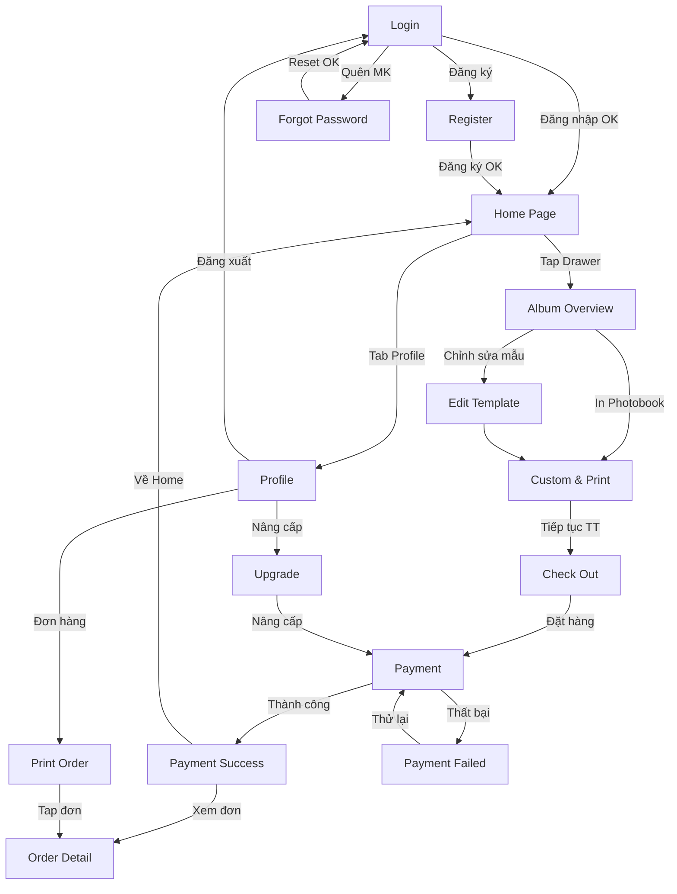

# Screen Inventory – Figma UI Mapping

> Tài liệu ánh xạ toàn bộ màn hình từ Figma design vào Functional Requirements.
>
> **Figma**: [demo-UI](https://www.figma.com/design/bM2eCmXry4iHPf6kP80ljB/demo-UI?node-id=0-1&t=k8nscHHRXGRE0UG9-1)
>
> **Phạm vi**: Toàn bộ luồng User trên mobile app. Chưa có luồng Admin.

---

## Tổng quan canvas

Figma design bao gồm **16 màn hình** chia theo các luồng nghiệp vụ:

```
┌──────────────┐    ┌──────────────┐    ┌───────────────┐
│  Auth Flow   │    │  Core Flow   │    │ Order Flow    │
│              │    │              │    │               │
│ • Login      │───▶│ • Home Page  │───▶│ • Check Out   │
│ • Register   │    │ • Profile    │    │ • Payment     │
│ • Forgot PW  │    │ • Album      │    │ • Payment OK  │
│              │    │   Overview   │    │ • Payment Fail│
│              │    │ • Custom &   │    │ • Order Detail│
│              │    │   Print      │    │ • Print Order │
│              │    │ • Edit       │    │   (History)   │
│              │    │   Template   │    │               │
│              │    │ • Upgrade    │    │               │
└──────────────┘    └──────────────┘    └───────────────┘
```

---

## Chi tiết từng màn hình

### 1. Login (Đăng nhập)

| Mục | Chi tiết |
|---|---|
| **Frame name** | `Login` |
| **FR liên quan** | FR-01.2 (Đăng nhập) |
| **Mô tả** | Màn hình đăng nhập với logo "PAUSE" nổi bật |
| **UI Elements** | Logo "Pause" (centered, dark background), Input: Email/Số điện thoại, Input: Mật khẩu, Link "Quên mật khẩu?", Button: "Đăng nhập" (primary CTA), Social login: Google + Apple, Link: "Chưa có tài khoản? Đăng ký ngay" |
| **Text content** | "Welcome back", "Email / Số điện thoại", "Mật khẩu", "Quên mật khẩu?", "Đăng nhập", "Hoặc tiếp tục với", "Chưa có tài khoản? Đăng ký ngay" |
| **Layout** | Vertical stack centered, logo area (dark) chiếm ~1/3 trên, form area (light) chiếm ~2/3 dưới |
| **Navigation** | → Register, → Forgot Password, → Home Page (sau đăng nhập thành công) |

---

### 2. Register (Đăng ký)

| Mục | Chi tiết |
|---|---|
| **Frame name** | `Register` |
| **FR liên quan** | FR-01.1 (Đăng ký tài khoản) |
| **Mô tả** | Form đăng ký tài khoản mới |
| **UI Elements** | Header: "Tạo tài khoản mới", Input: Họ và tên, Input: Email/Số điện thoại, Input: Mật khẩu, Input: Xác nhận mật khẩu, Checkbox: "Tôi đồng ý với Điều khoản sử dụng", Button: "Đăng ký" (primary CTA), Link: "Đã có tài khoản? Đăng nhập" |
| **Text content** | "Tạo tài khoản mới", "Họ và tên", "Email / Số điện thoại", "Mật khẩu", "Xác nhận mật khẩu", "Tôi đồng ý với Điều khoản sử dụng", "Đăng ký", "Đã có tài khoản? Đăng nhập" |
| **Layout** | Scrollable vertical form, sticky bottom CTA |
| **Navigation** | → Login, → Home Page (sau đăng ký thành công) |

---

### 3. Forgot Password (Quên mật khẩu)

| Mục | Chi tiết |
|---|---|
| **Frame name** | `Forgot Password` |
| **FR liên quan** | FR-01.4 (Quên mật khẩu) |
| **Mô tả** | Khôi phục mật khẩu qua email/SĐT |
| **UI Elements** | Back button, Logo "Pause", Instruction text, Input: Email/SĐT, Button: "Gửi mã xác nhận" |
| **Text content** | "Quên mật khẩu", "Nhập email hoặc số điện thoại của bạn để nhận mã khôi phục", "Gửi mã xác nhận" |
| **Layout** | Simple centered form |
| **Navigation** | ← Login |

---

### 4. Home Page (Trang chủ)

| Mục | Chi tiết |
|---|---|
| **Frame name** | `Home Page` |
| **FR liên quan** | FR-02.1 (Xem danh sách ngăn kéo) |
| **Mô tả** | Dashboard chính – hiển thị ngăn kéo kỷ niệm và quick actions |
| **UI Elements** | Header: Avatar + Notification bell, Greeting card ("Xin chào, [tên]"), Section: "Kỷ niệm gần đây" (carousel/grid các ngăn kéo), Quick action buttons: "Tạo tủ mới", "Photobooth nhanh", Bottom tab bar: Home / Explore / Memories / Profile |
| **Text content** | "Xin chào,", "Kỷ niệm gần đây", "Tủ kỷ niệm (Memory Drawers)", "Tạo tủ mới", "Photobooth nhanh" |
| **Layout** | Dashboard card grid + sticky bottom navigation |
| **Navigation** | → Album Overview (tap drawer), → Profile (tab), → Create Drawer |
| **Ghi chú** | Bottom tab có 4 mục: Home, Explore, Memories, Profile |

---

### 5. Profile (Hồ sơ cá nhân)

| Mục | Chi tiết |
|---|---|
| **Frame name** | `Profile` |
| **FR liên quan** | FR-01.5 (Quản lý hồ sơ cá nhân), FR-04.1 (Xem gói hội viên) |
| **Mô tả** | Trang thông tin cá nhân + menu settings |
| **UI Elements** | Avatar + Tên + Membership badge (Free/Premium), Menu list: "Quản lý đơn hàng", "Nâng cấp gói", "Cài đặt", "Hỗ trợ", "Đăng xuất", Bottom tab bar |
| **Text content** | "Tài khoản của tôi", "Thành viên Premium", "Quản lý đơn hàng", "Nâng cấp gói", "Cài đặt", "Đăng xuất" |
| **Layout** | Vertical menu list với avatar section ở trên |
| **Navigation** | → Print Order (Quản lý đơn hàng), → Upgrade (Nâng cấp gói), → Login (Đăng xuất) |

---

### 6. Album Overview (Chi tiết Ngăn kéo / Tủ kỷ niệm)

| Mục | Chi tiết |
|---|---|
| **Frame name** | `Album Overview` |
| **FR liên quan** | FR-02.6 (Xem ảnh trong ngăn kéo), FR-02.7 (Chia sẻ) |
| **Mô tả** | Xem chi tiết một ngăn kéo – grid ảnh + actions |
| **UI Elements** | Album cover photo (hero), Title + creation date + tag, Photo grid (thumbnails), Button: "Chỉnh sửa mẫu", Button: "In Photobook" (primary CTA), Share button |
| **Text content** | "Hành trình thanh xuân", "120 kỷ niệm", "Chỉnh sửa mẫu", "In Photobook", "Chia sẻ" |
| **Layout** | Gallery grid layout, sticky action bar ở bottom |
| **Navigation** | → Edit Template, → Custom & Print, → Share (modal) |
| **Ghi chú** | Đây chính là "Ngăn kéo kỷ niệm" trong domain glossary. Figma dùng từ "Album" |

---

### 7. Custom & Print (Tùy chỉnh & In ấn) – Có 2 variants

| Mục | Chi tiết |
|---|---|
| **Frame name** | `Custom & Print` (2 frames) |
| **FR liên quan** | FR-03.2 (Tạo photobooth từ template), FR-03.1 (Duyệt template) |
| **Mô tả** | Chọn template + tùy chỉnh sản phẩm in |
| **UI Elements** | Preview photobooth/photobook, Selector: Loại bìa (Bìa cứng / Bìa mềm), Selector: Loại giấy (Giấy mỹ thuật 200gsm), Indicator: Tổng số trang, Price display, Button: "Tiếp tục thanh toán" (primary CTA) |
| **Text content** | "Tùy chỉnh Photobook", "Loại bìa: Bìa cứng cao cấp", "Loại giấy: Giấy mỹ thuật 200gsm", "Tổng số trang: 24 trang", "Tổng tiền: 299,000đ", "Tiếp tục thanh toán" |
| **Layout** | Split view: preview trên + config options dưới |
| **Navigation** | ← Album Overview, → Check Out |
| **Ghi chú** | Figma mở rộng thêm sản phẩm **Photobook** (ngoài Photobooth). Có thể cần cập nhật FR |

---

### 8. Edit Template (Chỉnh sửa mẫu)

| Mục | Chi tiết |
|---|---|
| **Frame name** | `Edit Template` |
| **FR liên quan** | FR-03.2 (Tạo photobooth) |
| **Mô tả** | Canvas editor để chọn mẫu và tùy chỉnh |
| **UI Elements** | Template theme selector (Vintage, Modern, Minimalist, Pastel), Layout options, Text caption editor, Sticker/decoration toolbar, Button: "Lưu thay đổi" |
| **Text content** | "Chọn mẫu thiết kế", "Vintage Memories", "Thêm nhãn dán", "Chỉnh sửa chữ", "Lưu thay đổi" |
| **Layout** | Canvas workspace + sidebar tools + bottom thumbnail strip |
| **Navigation** | ← Album Overview, → Custom & Print |
| **Ghi chú** | ⚠️ Figma cho thấy user CÓ THỂ chỉnh sửa text, thêm sticker — điều này **khác với FR hiện tại** (FR-03.2 ghi user KHÔNG được edit template). Cần đồng bộ lại |

---

### 9. Check Out (Thanh toán đơn hàng)

| Mục | Chi tiết |
|---|---|
| **Frame name** | `Check Out` |
| **FR liên quan** | FR-03.3 (Đặt in photobooth), FR-05.1 (Payment Gateway) |
| **Mô tả** | Form checkout đặt hàng in ấn |
| **UI Elements** | Form: Tên người nhận, SĐT, Địa chỉ giao hàng, Ghi chú, Order summary (thumbnail + chi tiết), Input: Mã giảm phí vận chuyển, Chi tiết: Tạm tính / Phí vận chuyển / Tổng cộng, Payment method selector (MoMo, Banking, COD), Button: "Đặt hàng ngay" (primary CTA) |
| **Text content** | "Thông tin giao hàng", "Địa chỉ nhận hàng", "Mã giảm phí vận chuyển", "Chi tiết thanh toán", "Tạm tính", "Phí vận chuyển", "Tổng cộng", "Đặt hàng ngay" |
| **Layout** | Standard e-commerce checkout, scrollable |
| **Navigation** | ← Custom & Print, → Payment |
| **Ghi chú** | Có hỗ trợ **mã giảm giá** — chưa có trong FR. Có **COD** (thanh toán khi nhận hàng) — chưa có trong FR |

---

### 10. Payment (Cổng thanh toán)

| Mục | Chi tiết |
|---|---|
| **Frame name** | `Payment` |
| **FR liên quan** | FR-05.1 (Tích hợp Payment Gateway) |
| **Mô tả** | Màn hình thanh toán QR code |
| **UI Elements** | QR code (VietQR/MoMo), Bank transfer info (nội dung chuyển khoản), Countdown timer, Button: "Tôi đã hoàn tất thanh toán", Button: Cancel |
| **Text content** | "Quét mã QR để thanh toán", "Nội dung chuyển khoản", "Số tiền", "Đang chờ thanh toán...", "Tôi đã hoàn tất thanh toán" |
| **Layout** | Centered around QR code, modal-like |
| **Navigation** | → Payment Success / Payment Failed |

---

### 11. Payment Success (Thanh toán thành công)

| Mục | Chi tiết |
|---|---|
| **Frame name** | `Payment Success` |
| **FR liên quan** | FR-05.1, FR-03.4 |
| **Mô tả** | Xác nhận thanh toán thành công |
| **UI Elements** | Checkmark icon (success), Mã đơn hàng, Ngày giao dự kiến, Button: "Xem chi tiết đơn hàng", Button: "Về trang chủ" |
| **Text content** | "Thanh toán thành công!", "Mã đơn hàng: #PS-88392", "Dự kiến giao hàng: 22/10/2026", "Xem chi tiết đơn hàng", "Về trang chủ" |
| **Layout** | Centered celebration layout |
| **Navigation** | → Order Detail, → Home Page |

---

### 12. Payment Failed (Thanh toán thất bại)

| Mục | Chi tiết |
|---|---|
| **Frame name** | `Payment Failed` |
| **FR liên quan** | FR-05.1 |
| **Mô tả** | Thông báo thanh toán thất bại |
| **UI Elements** | Error icon, Failure message, Button: "Thử lại", Link: "Hỗ trợ khách hàng" |
| **Text content** | "Thanh toán không thành công", "Giao dịch đã bị hủy hoặc hết hạn", "Thử lại", "Hỗ trợ khách hàng" |
| **Layout** | Centered error state |
| **Navigation** | → Payment (retry), → Support |

---

### 13. Order Detail (Chi tiết đơn hàng)

| Mục | Chi tiết |
|---|---|
| **Frame name** | `Order Detail` |
| **FR liên quan** | FR-03.4 (Theo dõi đơn hàng) |
| **Mô tả** | Chi tiết + timeline trạng thái đơn hàng |
| **UI Elements** | Order status tracker (Pending → Printing → Shipping → Delivered), Item thumbnail + details, Shipping address, Payment status, Invoice breakdown, Action buttons |
| **Text content** | "Chi tiết đơn hàng #PS-88392", "Trạng thái: Đang in ấn", "Sản phẩm: Photobook Bìa cứng (24 trang)", "Địa chỉ giao hàng", "Tổng tiền" |
| **Layout** | Vertical timeline tracker + order detail cards |
| **Navigation** | ← Print Order |

---

### 14. Print Order (Lịch sử đơn in)

| Mục | Chi tiết |
|---|---|
| **Frame name** | `Print Order` |
| **FR liên quan** | FR-03.4 (Theo dõi đơn hàng) |
| **Mô tả** | Danh sách tất cả đơn hàng in ấn |
| **UI Elements** | Filter tabs: Tất cả / Đang xử lý / Đã hoàn thành, Order cards (thumbnail, tên, trạng thái badge, giá), Button: "Đặt lại" (re-order) |
| **Text content** | "Lịch sử đơn in", "Tất cả đơn hàng", "Đang xử lý", "Đã hoàn thành", "Đặt lại" |
| **Layout** | List view + filter chips |
| **Navigation** | → Order Detail (tap vào đơn) |

---

### 15. Upgrade (Nâng cấp tài khoản)

| Mục | Chi tiết |
|---|---|
| **Frame name** | `Upgrade` |
| **FR liên quan** | FR-04.1, FR-04.2 (Gói hội viên) |
| **Mô tả** | So sánh và đăng ký gói hội viên |
| **UI Elements** | Comparison table: Free vs. Premium, Feature checklist (unlimited storage, 4K video, free monthly prints), Billing toggle: Monthly / Annual, Button: "Nâng cấp ngay" (primary CTA) |
| **Text content** | "Nâng cấp Pause Premium", "Lưu trữ không giới hạn", "In ấn ưu đãi mỗi tháng", "Gói 1 năm (Tiết kiệm 30%)", "Nâng cấp ngay" |
| **Layout** | Promotional comparison cards |
| **Navigation** | → Payment (khi nâng cấp) |
| **Ghi chú** | Figma đề cập "4K video" và "unlimited storage" — cần xác nhận có hỗ trợ video không |

---

## Navigation Flow Map



---

## Các điểm khác biệt Figma vs. FR hiện tại

> ⚠️ Các điểm dưới đây cần bạn xác nhận để đồng bộ tài liệu.

| # | Điểm khác biệt | Figma | FR hiện tại | Cần hành động |
|---|---|---|---|---|
| 1 | **Edit Template** | User CÓ THỂ chỉnh sửa text, thêm sticker | FR-03.2: User KHÔNG được edit template | Cập nhật FR hoặc sửa Figma? |
| 2 | **Sản phẩm Photobook** | Figma có "Photobook Bìa cứng 24 trang" | FR chỉ đề cập Photobooth strip | Thêm Photobook vào FR? |
| 3 | **Mã giảm giá** | Checkout có ô nhập "Mã giảm phí vận chuyển" | Chưa có FR cho voucher/promo | Thêm FR mới? |
| 4 | **COD** | Checkout có "COD" (thanh toán khi nhận hàng) | FR chỉ liệt kê VNPay/MoMo/ZaloPay | Thêm COD vào FR? |
| 5 | **4K Video** | Upgrade screen đề cập "4K video" | FR chỉ nói về ảnh | Có hỗ trợ video không? |
| 6 | **Apple Sign-in** | Login có nút Apple sign-in | FR chỉ nói Google OAuth | Thêm Apple Sign-in? |
| 7 | **Re-order** | Print Order có nút "Đặt lại" | Chưa có FR cho re-order | Thêm FR? |
| 8 | **Bottom tabs** | 4 tabs: Home / Explore / Memories / Profile | FR chưa mô tả "Explore" | Explore là gì? |

---

## Design System (quan sát từ Figma)

### Color Scheme
- **Primary**: Dark / Black (logo area, headers)
- **Background**: Light gray / White
- **Accent**: Phụ thuộc vào CTA buttons
- **Style**: Minimalist, clean, grayscale-dominant

### Typography
- Tiêu đề: Bold, kích thước lớn
- Body: Regular weight
- Ngôn ngữ UI: **Tiếng Việt**

### UI Patterns
- **Bottom Tab Bar**: 4 tabs cố định trên mọi màn hình chính
- **Card-based layout**: Ngăn kéo, đơn hàng hiển thị dạng card
- **Sticky bottom CTA**: Nút hành động chính luôn ở dưới cùng
- **Status timeline**: Đơn hàng dùng vertical timeline tracker
- **Modal/Sheet**: Chia sẻ ngăn kéo dùng bottom sheet
