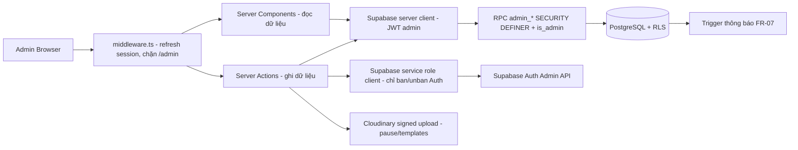
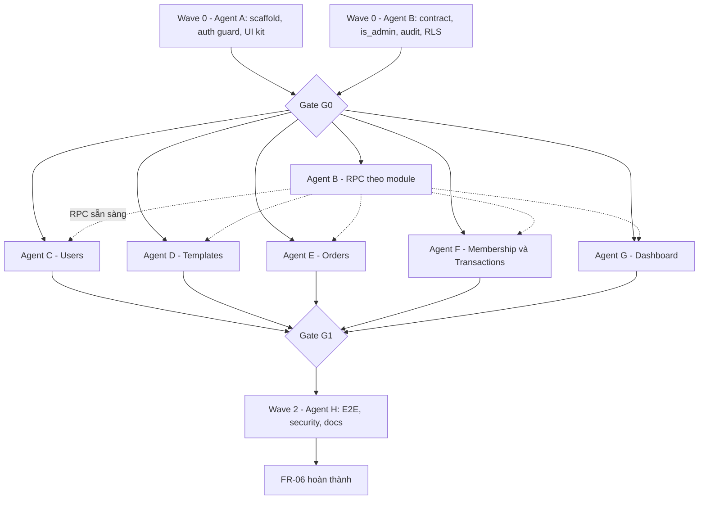

# Task Breakdown – FR-06: Quản trị hệ thống (Admin Dashboard)

> **Module**: Admin Dashboard (Next.js Web + Supabase)
> **Trạng thái**: 🟡 Hoàn thành phần Web + Supabase Backend (**80/84** task — còn `H05`/`H06` kiểm thử 4 trình duyệt & tải 5.000 đơn trên môi trường live, và `X01`/`X02` thuộc nhánh mobile `mobile-app_dev`). Xem biên bản: [completed/fr-06-admin.md](../completed/fr-06-admin.md)
> **Liên kết FR**: [01-fr.md – FR-06](../../01-BA/SRS/01-fr.md#fr-06-quản-trị-hệ-thống-admin)
> **Tách ra từ**: [task-breakdown.md – FR-06](task-breakdown.md#task-breakdown--fr-06-quản-trị-hệ-thống-admin)
> **Nhánh git**: `webapp-dev` (mỗi agent làm trên nhánh con `webapp-dev-fr06-<module>` rồi merge về `webapp-dev`; không đụng `main`)
> **Nguồn tham chiếu**: chỉ dựa trên tài liệu trong `docs/` (SRS, glossary, system-design, folder-structure, db-schema, storage-strategy, NFR) – **chưa đối chiếu code**, agent phải tự rà lại schema thực tế ở bước `B-01`.

---

## 1. Mục tiêu & phạm vi

### 1.1 Yêu cầu chức năng cần bao phủ

| FR | Tên | Ưu tiên | Chức năng bắt buộc (theo SRS) | Agent phụ trách |
|---|---|---|---|---|
| FR-06.1 | Quản lý người dùng | 🟡 | Xem danh sách, tìm kiếm, xem chi tiết, khóa / mở khóa tài khoản | **Agent C** |
| FR-06.2 | Quản lý template | 🔴 | Tạo, sửa, ẩn/hiện, xóa template; tag free/premium; phân loại category | **Agent D** |
| FR-06.3 | Quản lý đơn hàng | 🔴 | Xem danh sách, lọc theo trạng thái, xem chi tiết, cập nhật trạng thái | **Agent E** |
| FR-06.4 | Quản lý gói hội viên | 🟡 | CRUD gói, cấu hình quyền lợi (số ngăn kéo, dung lượng, template) + danh sách hội viên | **Agent F** |
| FR-06.5 | Dashboard thống kê | 🟢 | Tổng user, user mới, đơn hàng hôm nay, doanh thu tháng, top template | **Agent G** |
| FR-05.2 *(phía admin)* | Lịch sử giao dịch & đối soát | 🟢 | Admin xem giao dịch (`pending/success/failed/refunded`), mã `order_code`, mã gateway | **Agent F** |
| Nền tảng | Auth admin, layout, bảo mật | 🔴 | Đăng nhập admin, chặn non-admin, service role chỉ ở server | **Agent A + B** |

### 1.2 Ngoài phạm vi (không làm trong file này)

- Landing page / download / blog của web (thuộc web marketing, làm riêng).
- Nghiệp vụ core của mobile (ngăn kéo, photobooth, đặt in) – web **không** chứa logic nghiệp vụ mobile (AGENTS.md).
- Admin **không** được duyệt / xem ảnh riêng tư trong ngăn kéo của user (quyền riêng tư – NFR-04.2). Admin chỉ thấy số liệu tổng hợp và ảnh **thuộc đơn in** (cần để in).
- Push FCM cho admin (FR-07 đã có trigger tạo thông báo cho user khi đơn đổi trạng thái).

### 1.3 Ràng buộc bắt buộc (từ AGENTS.md / NFR)

| # | Ràng buộc |
|---|---|
| R1 | Next.js 14+ **App Router**, TypeScript strict, **Server Components mặc định**, `"use client"` chỉ khi cần tương tác |
| R2 | Styling: **Vanilla CSS / CSS Modules**, **không TailwindCSS** |
| R3 | Admin chưa có Figma → theo **Material Design 3** (màu thương hiệu Pause: primary `#630D11`, primary-container `#FDF2F2`, nền `#F7F6F5`, ink `#111111`) |
| R4 | Supabase là backend duy nhất – không dựng Express/NestJS. Logic server dùng **Server Actions / Route Handlers** của Next.js + **RPC Postgres** |
| R5 | **Không bao giờ** đưa `SUPABASE_SERVICE_ROLE_KEY`, `CLOUDINARY_API_SECRET` ra client; mọi file dùng chúng phải `import "server-only"` |
| R6 | **Luôn bật RLS**; mọi RPC admin là `SECURITY DEFINER` + kiểm tra `is_admin()` ở dòng đầu |
| R7 | Validate input ở cả client (zod) và server (zod trong Server Action + constraint/trigger Postgres) – NFR-04.6 |
| R8 | Code/comment tiếng Anh, UI & tài liệu tiếng Việt; thời gian hiển thị theo `Asia/Ho_Chi_Minh`, tiền `VNĐ` |
| R9 | Hiệu năng: API list ≤ 500ms cho 95% request (NFR-01.1) → phân trang server-side, có index |
| R10 | Trình duyệt: Chrome, Firefox, Safari, Edge – 2 bản mới nhất (NFR-06.4); contrast ≥ 4.5:1 (NFR-05.3) |
| R11 | Khi thêm bảng/cột/RPC → cập nhật `db-schema.md`; khi thêm FR → cập nhật `01-fr.md` |
| R12 | Commit theo Conventional Commits; chỉ commit khi chức năng xong và user xác nhận (nếu có yêu cầu sửa) |

---

## 2. Kiến trúc tổng thể Admin



**Nguyên tắc dữ liệu**

1. **Đọc**: Server Component gọi RPC `admin_*` bằng **JWT của admin** (không dùng service role) → RLS + `is_admin()` là lớp bảo vệ cuối.
2. **Ghi**: Server Action → `requireAdmin()` → validate zod → RPC `admin_*` (RPC tự ghi `admin_audit_logs`) → `revalidatePath()`.
3. **Service role** chỉ dùng cho thao tác bắt buộc phải gọi Auth Admin API (ban/unban user). Không dùng service role để đọc bảng.
4. Upload ảnh template: Server Action ký upload Cloudinary (API secret ở server) vào folder `pause/templates` (ưu tiên theo storage-strategy §6); fallback bucket public `templates` của Supabase.

### 2.1 Cấu trúc thư mục đích (`app/web/`)

```
app/web/
├── package.json · next.config.ts · tsconfig.json · .env.example · README.md
├── playwright.config.ts · vitest.config.ts
├── src/
│   ├── middleware.ts                         # [A] session refresh + chặn /admin
│   ├── app/
│   │   ├── layout.tsx · page.tsx             # [A] root (landing placeholder – ngoài scope)
│   │   ├── (admin-auth)/admin/login/page.tsx # [A] đăng nhập admin
│   │   └── (admin)/admin/
│   │       ├── layout.tsx                    # [A] shell: sidebar + header + requireAdmin
│   │       ├── page.tsx                      # [G] dashboard
│   │       ├── users/ · users/[id]/          # [C]
│   │       ├── templates/ · templates/new/ · templates/[id]/   # [D]
│   │       ├── orders/ · orders/[id]/        # [E]
│   │       ├── membership/plans/ · membership/plans/[id]/ · membership/subscribers/  # [F]
│   │       ├── transactions/                 # [F]
│   │       ├── forbidden/page.tsx · error.tsx · loading.tsx · not-found.tsx   # [A]
│   ├── features/
│   │   ├── users/      {queries.ts, actions.ts, schemas.ts, components/}   # [C]
│   │   ├── templates/  {queries.ts, actions.ts, schemas.ts, layout/, components/}  # [D]
│   │   ├── orders/     {queries.ts, actions.ts, schemas.ts, status-machine.ts, components/}  # [E]
│   │   ├── membership/ {queries.ts, actions.ts, schemas.ts, components/}   # [F]
│   │   ├── transactions/ {queries.ts, components/}                          # [F]
│   │   └── dashboard/  {queries.ts, components/}                            # [G]
│   ├── components/
│   │   ├── ui/        # [A] Button, TextField, Select, Switch, StatusChip, DataTable, Pagination,
│   │   │              #     SearchInput, FilterBar, Dialog, ConfirmDialog, Toast, EmptyState, Skeleton
│   │   └── layout/    # [A] AdminSidebar, AdminHeader, PageHeader
│   ├── lib/
│   │   ├── supabase/{client.ts, server.ts, admin.ts}   # [A] admin.ts = service role, server-only
│   │   ├── auth/require-admin.ts                       # [A]
│   │   ├── cloudinary/sign-upload.ts                   # [D] server-only
│   │   ├── env.ts · format.ts · pagination.ts · action-result.ts · errors.ts   # [A]
│   │   └── nav.ts                                      # [A] cấu hình menu – điền sẵn đủ route ở Wave 0
│   ├── types/database.ts                               # [A] sinh từ `supabase gen types`
│   └── styles/{tokens.css, globals.css}                # [A]
└── tests/{unit/, e2e/}                                 # [H] (feature agent viết test của module mình)
```

`[X]` = agent sở hữu file. **Chỉ agent sở hữu mới được sửa**; agent khác cần thay đổi thì gửi yêu cầu lên board cho chủ sở hữu (xem §6).

---

## 3. Đã có sẵn (không làm lại, chỉ xác minh)

- [x] **T-06.P1** – Cột `public.profiles.role` (`'user' | 'admin'`) trong baseline SQL *(trước đây T-06.13)*
- [x] **T-06.P2** – RLS admin trên `print_orders` và `photobooth_templates` *(trước đây T-06.14 – `B-05`/`B-09` rà lại quyền ghi)*
- [x] **T-06.P3** – RPC `admin_dashboard_stats()` bản đầu (ghi trong biên bản FR-03 – `B-18` mở rộng)

---

## 4. Lộ trình song song (Waves)



| Wave | Thời lượng ước tính | Agent chạy song song | Đầu ra / Gate |
|---|---|---|---|
| **Wave 0 – Nền tảng** | 1.5–2 ngày | **A** (web platform) ‖ **B** (DB contract + bảo mật lõi) | **G0**: `npm run dev` chạy; `/admin` chặn non-admin; login admin OK; UI kit + `nav.ts` đủ route; contract §5 được B xác nhận "FROZEN"; `types/database.ts` sinh được |
| **Wave 1 – Tính năng** | 3–4 ngày | **C ‖ D ‖ E ‖ F ‖ G** + **B** (RPC từng module) + **A** (hỗ trợ UI kit) + **H** (dựng khung test) | **G1**: mọi trang chạy với RPC thật, test unit của module xanh, không lỗi TypeScript/ESLint |
| **Wave 2 – Tích hợp** | 1.5–2 ngày | **H** dẫn dắt; chủ module sửa bug được giao | E2E xanh, checklist bảo mật đạt, tài liệu cập nhật, biên bản `completed/fr-06-admin.md` |

> [!TIP]
> Trong Wave 1, feature agent **không phải chờ** RPC của B: viết `queries.ts` theo đúng chữ ký ở §5 và tạm trả dữ liệu mock (`USE_MOCK_ADMIN_DATA=true` trong `.env.local`). Khi B báo RPC đã merge, chỉ cần tắt cờ mock – không đổi UI.

**Thứ tự ưu tiên khi thiếu người**: A → B → E (Orders 🔴) → D (Templates 🔴) → C → F → G → H.

---

## 5. Contract dùng chung (chốt trong Wave 0 – mọi agent tuân theo)

### 5.1 Quy ước URL & phân trang

- Query string: `?q=&status=&tier=&category=&plan=&from=YYYY-MM-DD&to=YYYY-MM-DD&page=1&pageSize=20&sort=created_at.desc`
- `pageSize` ∈ {10, 20, 50}; mặc định 20. Mọi RPC list nhận `p_limit`, `p_offset` và trả cột `total_count` (window `count(*) over()`).
- Filter/search đồng bộ lên URL (giữ được khi reload / chia sẻ link).

### 5.2 Kết quả Server Action

```ts
// src/lib/action-result.ts
export type ActionResult<T = void> =
  | { ok: true; data: T; message?: string }
  | { ok: false; code: AdminErrorCode; message: string; fieldErrors?: Record<string, string[]> };
```

### 5.3 Mã lỗi chuẩn (RPC `raise exception using errcode = 'P0001', message = '<CODE>'`)

| Code | Khi nào | Thông báo UI (vi) |
|---|---|---|
| `ADMIN_REQUIRED` | Người gọi không phải admin / bị khóa | "Bạn không có quyền quản trị." |
| `NOT_FOUND` | Không tìm thấy bản ghi | "Không tìm thấy dữ liệu." |
| `CANNOT_LOCK_SELF` | Admin tự khóa mình | "Không thể tự khóa tài khoản của bạn." |
| `CANNOT_LOCK_ADMIN` | Khóa một admin khác | "Không thể khóa tài khoản quản trị viên." |
| `LOCK_REASON_REQUIRED` | Khóa mà không có lý do | "Vui lòng nhập lý do khóa." |
| `INVALID_STATUS_TRANSITION` | Chuyển trạng thái đơn sai luồng | "Không thể chuyển sang trạng thái này." |
| `CANCEL_NOTE_REQUIRED` | Hủy đơn không ghi chú | "Vui lòng nhập lý do hủy đơn." |
| `TEMPLATE_NAME_TAKEN` | Trùng tên template | "Tên template đã tồn tại." |
| `TEMPLATE_IN_USE` | Xóa template đã được dùng | "Template đã được sử dụng, hãy ẩn thay vì xóa." |
| `INVALID_LAYOUT_CONFIG` | `layout_config` sai cấu trúc | "Cấu hình bố cục không hợp lệ." |
| `PLAN_NAME_TAKEN` | Trùng tên gói | "Tên gói đã tồn tại." |
| `PLAN_IN_USE` | Xóa gói đã có người đăng ký | "Gói đã có hội viên, hãy ngừng bán thay vì xóa." |

### 5.4 Máy trạng thái đơn in (theo domain-glossary)

| Từ \ Sang | processing | printing | shipping | completed | cancelled |
|---|---|---|---|---|---|
| **pending** (Chờ xác nhận) | ✅ | | | | ✅ *(bắt buộc ghi chú)* |
| **processing** (Đang xử lý) | | ✅ | | | ✅ *(bắt buộc ghi chú)* |
| **printing** (Đang in) | | | ✅ | | |
| **shipping** (Đang giao) | | | | ✅ | |
| **completed** / **cancelled** | — trạng thái cuối, không chuyển tiếp — | | | | |

- Đơn thanh toán VietQR/PayOS thành công được hệ thống tự chuyển `pending → processing` (FR-05). Đơn COD do admin xác nhận.
- Logic này tồn tại **2 nơi** và phải khớp nhau: `src/features/orders/status-machine.ts` (ẩn nút sai) và RPC `admin_update_order_status` (nguồn sự thật).

### 5.5 Chữ ký RPC (Agent B triển khai, các agent khác gọi)

| RPC | Tham số | Trả về | Dùng bởi |
|---|---|---|---|
| `is_admin()` | – | `boolean` (role = admin và không bị khóa) | RLS, mọi RPC |
| `admin_list_users` | `p_search text, p_tier text, p_status text, p_role text, p_sort text, p_limit int, p_offset int` | `table(id, display_name, email, phone, avatar_url, role, tier, is_locked, drawer_count, created_at, last_sign_in_at, total_count)` | C |
| `admin_get_user_detail` | `p_user_id uuid` | `jsonb {profile, email, memberships[], drawer_stats{drawer_count, photo_count, storage_used_bytes}, orders_summary, recent_orders[], recent_transactions[]}` | C |
| `admin_set_user_lock` | `p_user_id uuid, p_locked boolean, p_reason text` | `jsonb {id, is_locked, locked_at}` | C |
| `admin_list_templates` | `p_search, p_category, p_is_premium bool, p_is_active bool, p_limit, p_offset` | `table(id, name, category, preview_url, slot_count, is_premium, is_active, usage_count, updated_at, total_count)` | D |
| `admin_upsert_template` | `p_id uuid null, p_name, p_category, p_preview_url, p_is_premium, p_is_active, p_layout_config jsonb` | `jsonb` template | D |
| `admin_set_template_active` | `p_id uuid, p_active boolean` | `void` | D |
| `admin_delete_template` | `p_id uuid` | `void` (lỗi `TEMPLATE_IN_USE`) | D |
| `admin_list_orders` | `p_status, p_search, p_from date, p_to date, p_sort, p_limit, p_offset` | `table(id, short_code, user_id, customer_name, shipping_phone, template_name, preview_url, quantity, total_price_vnd, status, payment_status, payment_method, created_at, total_count)` | E |
| `admin_order_status_counts` | `p_from date, p_to date` | `table(status, count)` | E, G |
| `admin_get_order_detail` | `p_order_id uuid` | `jsonb {order, customer, photobooth_item, template, slot_photos[{slot_index, original_url, thumbnail_url, width, height}], transactions[], status_history[]}` | E |
| `admin_update_order_status` | `p_order_id uuid, p_new_status text, p_note text` | `jsonb` order | E |
| `admin_update_order_notes` | `p_order_id uuid, p_admin_notes text` | `void` | E |
| `admin_list_membership_plans` | `p_include_inactive bool` | `table(..., subscriber_count, active_subscriber_count)` | F |
| `admin_upsert_membership_plan` | `p_id uuid null, p_name, p_description, p_price_vnd int, p_duration_type, p_extra_drawers int, p_extra_storage_bytes bigint, p_access_premium_templates bool, p_is_active bool` | `jsonb` plan | F |
| `admin_delete_membership_plan` | `p_id uuid` | `void` (lỗi `PLAN_IN_USE`) | F |
| `admin_list_memberships` | `p_status, p_plan_id, p_expiring_within_days int, p_search, p_limit, p_offset` | `table(id, user_id, display_name, email, plan_name, started_at, expires_at, days_left, status, total_count)` | F |
| `admin_list_transactions` | `p_type, p_status, p_search, p_from, p_to, p_limit, p_offset` | `table(id, user_id, display_name, type, amount_vnd, payment_method, payment_gateway_ref, order_code, status, order_id, created_at, total_count)` | F |
| `admin_dashboard_stats` | `p_from date, p_to date` | `jsonb {total_users, new_users, orders_today, pending_orders, revenue_month_vnd, revenue_range_vnd, active_members}` | G |
| `admin_revenue_series` | `p_from date, p_to date, p_granularity text ('day'/'week'/'month')` | `table(bucket date, print_revenue_vnd, membership_revenue_vnd, order_count)` | G |
| `admin_top_templates` | `p_from date, p_to date, p_limit int` | `table(template_id, name, preview_url, order_count, revenue_vnd)` | G |
| `admin_membership_distribution` | – | `table(plan_name, active_count)` (+ dòng `Free`) | G |

> [!IMPORTANT]
> `tier` của user được **suy ra**: có membership `active` còn hạn → tên gói (`PAUSE Go/Plus/Premium`), ngược lại `Free`. Doanh thu chỉ tính `transactions.status = 'success'`, ngày theo múi giờ `Asia/Ho_Chi_Minh`.

---

## 6. Quy tắc phối hợp giữa các agent

1. **Sở hữu file** theo cột `[X]` ở §2.1. Không sửa file của agent khác – gửi yêu cầu trên board kèm mô tả API mong muốn.
2. **Migration**: chỉ Agent B tạo file trong `supabase/migrations/` (đặt tên `YYYYMMDDHHMMSS_fr06_<mô_tả>.sql`, mỗi đợt một file, không sửa file đã merge). Feature agent cần cột/RPC mới → yêu cầu B.
3. **Shared UI** (`components/ui`, `styles/`, `nav.ts`, `middleware.ts`, `lib/supabase/*`) do Agent A sở hữu; A phải điền sẵn **đủ mục menu** trong Wave 0 để không ai phải sửa `nav.ts` sau đó.
4. **Types**: sau mỗi migration, B báo → A chạy `npm run gen:types` và commit `types/database.ts`.
5. **Mỗi agent** làm trên working copy riêng (nhánh `webapp-dev-fr06-<module>`), rebase từ `webapp-dev` trước khi bàn giao; coordinator merge.
6. **Bàn giao** = đạt Definition of Done (§8) + đăng trên board: các route đã làm, RPC đã dùng, cách test, ảnh chụp màn hình.
7. Phát hiện sai lệch tài liệu ↔ schema thực tế → báo B + coordinator, **không tự đoán**.

---

## 7. Danh sách task theo agent

Mức ưu tiên: **P0** = bắt buộc cho FR, **P1** = nên có, **P2** = tốt nếu có (làm khi còn thời gian).

### 🅰️ Agent A – Web Platform & Design System (Wave 0, sau đó hỗ trợ)

**Sở hữu**: `app/web/` (scaffold), `src/middleware.ts`, `src/app/(admin-auth)/`, `src/app/(admin)/admin/{layout,error,loading,not-found,forbidden}`, `src/components/`, `src/lib/{supabase,auth,env,format,pagination,action-result,errors,nav}`, `src/styles/`, `src/types/database.ts`.
**Phụ thuộc**: B-01, B-02 (để `requireAdmin` gọi `is_admin()`).

- [x] **T-06.A01** (P0) – Khởi tạo Next.js 14+ (App Router, TypeScript strict, ESLint, alias `@/`), **không** Tailwind, trong `app/web` *(gốc T-06.01)*
- [x] **T-06.A02** (P0) – `.env.example` + `src/lib/env.ts` & `src/lib/public-env.ts` validate biến môi trường bằng zod: `NEXT_PUBLIC_SUPABASE_URL`, `NEXT_PUBLIC_SUPABASE_ANON_KEY`, `SUPABASE_SERVICE_ROLE_KEY`, `CLOUDINARY_CLOUD_NAME`, `CLOUDINARY_API_KEY`, `CLOUDINARY_API_SECRET`, `USE_MOCK_ADMIN_DATA`
- [x] **T-06.A03** (P0) – Supabase clients với `@supabase/ssr`: `client.ts` (browser), `server.ts` (cookies), `admin.ts` (service role, `import "server-only"`) *(gốc T-06.02, T-06.15)*
- [x] **T-06.A04** (P0) – `middleware.ts`: refresh session, chặn `/admin/**` (trừ `/admin/login`) khi chưa đăng nhập → redirect kèm `?next=` *(gốc T-06.04)*
- [x] **T-06.A05** (P0) – `requireAdmin()` (server): lấy user → gọi `is_admin()` → non-admin/bị khóa: `signOut` + redirect `/admin/login?error=forbidden`; trả `{ user, profile }` cho layout & Server Action *(gốc T-06.04)*
- [x] **T-06.A06** (P0) – Design tokens MD3 bằng CSS variables (`tokens.css`): color roles từ màu thương hiệu, typography scale, shape, elevation, spacing, state layers; font hỗ trợ tiếng Việt; kiểm contrast ≥ 4.5:1
- [x] **T-06.A07** (P0) – Admin shell: `AdminSidebar` (Dashboard, Người dùng, Templates, Đơn hàng, Gói hội viên, Hội viên, Giao dịch – điền sẵn **đủ** trong `nav.ts`), `AdminHeader` (tên admin, đăng xuất), responsive thu gọn < 1024px *(gốc T-06.03)*
- [x] **T-06.A08** (P0) – UI kit `components/ui`: Button, IconButton, TextField, Textarea, Select, Switch, Checkbox, StatusChip, Card, DataTable (cột cấu hình, sort qua URL), Pagination, SearchInput (debounce 300ms), FilterBar, DateRangePicker, Dialog, ConfirmDialog, Toast, EmptyState, ErrorState, Skeleton, PageHeader – có ví dụ dùng trong `README`
- [x] **T-06.A09** (P0) – Tiện ích dùng chung: `formatVnd`, `formatDate`/`formatDateTime` (`vi-VN`, `Asia/Ho_Chi_Minh`), `formatBytes`, `parsePagination(searchParams)`, `ActionResult`, `mapPostgresError()` → bảng mã lỗi §5.3
- [x] **T-06.A10** (P0) – Trang **Đăng nhập Admin** `/admin/login`: email/mật khẩu (Supabase Auth), lỗi tiếng Việt, xử lý `?error=forbidden|locked`, chống double-submit *(gốc T-06.05)*
- [x] **T-06.A11** (P1) – `error.tsx`, `loading.tsx`, `not-found.tsx`, trang `forbidden` cho khu admin
- [x] **T-06.A12** (P0) – Script `npm run gen:types` (`supabase gen types typescript`) & `src/types/database.ts` đồng bộ đủ schema + 21 RPC FR-06 *(chạy lại `gen:types` khi nối Supabase local live)*
- [x] **T-06.A13** (P1) – `README.md` web (setup, env, chạy, deploy Vercel với Root Directory `app/web`)

**Definition of Done riêng**: admin đăng nhập được; user thường bị chặn; build `next build` không lỗi; không có secret trong bundle client (`grep` thư mục `.next/static`).

---

### 🅱️ Agent B – Supabase Backend cho Admin (Wave 0 → Wave 1)

**Sở hữu**: `supabase/migrations/*_fr06_*.sql`, `supabase/tests/`, `supabase/seed/admin_*.sql`, `docs/03-References/db-schema.md` (phần admin).
**Phụ thuộc**: không (là gốc của chuỗi phụ thuộc).

*Wave 0 – contract & bảo mật lõi*

- [x] **T-06.B01** (P0) – Rà schema thực tế so với `db-schema.md` + contract §5; sửa contract nếu lệch, đăng "CONTRACT FROZEN" lên board
- [x] **T-06.B02** (P0) – Hàm `public.is_admin()` (`SECURITY DEFINER`, `STABLE`, `search_path = public`): `role = 'admin' AND NOT is_locked`
- [x] **T-06.B03** (P0) – Cột khóa tài khoản trên `profiles`: `is_locked boolean default false`, `locked_at timestamptz`, `locked_reason text`; trigger bảo vệ: user không tự đổi `role`/`is_locked`/`locked_*`
- [x] **T-06.B04** (P0) – Bảng `admin_audit_logs` (`id, admin_id, action, entity_type, entity_id, before jsonb, after jsonb, created_at`) + RLS (admin chỉ SELECT) + hàm nội bộ `log_admin_action(...)`
- [x] **T-06.B05** (P0) – RLS đọc cho admin (`using (is_admin())`): `profiles`, `memberships`, `membership_plans` (kể cả inactive), `transactions`, `photobooth_items`, `photobooth_photos`; `photos` **chỉ** những ảnh thuộc `photobooth_photos` của item đã đặt in (bảo vệ quyền riêng tư) *(rà lại T-06.P2)*

*Wave 1 – RPC theo module (làm theo thứ tự ưu tiên E → D → C → F → G)*

- [x] **T-06.B06** (P0) – Bảng `print_order_status_history` (`order_id, from_status, to_status, changed_by, note, created_at`) + RLS (owner đơn & admin SELECT)
- [x] **T-06.B07** (P0) – RPC `admin_list_orders`, `admin_order_status_counts`, `admin_get_order_detail`
- [x] **T-06.B08** (P0) – RPC `admin_update_order_status` theo máy trạng thái §5.4 (khóa row `FOR UPDATE`, ghi history + audit, cập nhật `updated_at`) và `admin_update_order_notes`
- [x] **T-06.B09** (P0) – **Đồng bộ trigger `notify_print_order_status`** (migration FR-07 `20261120000000`) với 6 trạng thái chuẩn – tài liệu dùng `processing`/`completed`, trigger hiện viết `confirmed`/`delivered` → thông báo cho `processing` & `completed` sẽ không bắn
- [x] **T-06.B10** (P0) – Templates: policy ghi cho admin, trigger `updated_at`, trigger validate `layout_config` (có `width`,`height`,`slots[]`; `slot_count = jsonb_array_length(slots)`), unique `name`; RPC `admin_list_templates`, `admin_upsert_template`, `admin_set_template_active`, `admin_delete_template` (lỗi `TEMPLATE_IN_USE` nếu đã có `photobooth_items`) *(rà lại T-06.P2)*
- [x] **T-06.B11** (P1) – Storage bucket `templates` (public read) + policy ghi chỉ admin (fallback khi không dùng Cloudinary)
- [x] **T-06.B12** (P0) – RPC `admin_list_users` (join `auth.users` lấy email, `last_sign_in_at`; suy ra `tier`; đếm drawer), `admin_get_user_detail` (chỉ số liệu tổng hợp, không trả URL ảnh ngăn kéo)
- [x] **T-06.B13** (P0) – RPC `admin_set_user_lock`: chặn tự khóa / khóa admin, bắt buộc lý do khi khóa, ghi audit, tạo thông báo `system` cho user
- [x] **T-06.B14** (P0) – Membership plans: constraint (`price_vnd >= 0`, `extra_* >= 0`, unique `name`), RPC `admin_list_membership_plans`, `admin_upsert_membership_plan`, `admin_delete_membership_plan` (lỗi `PLAN_IN_USE`)
- [x] **T-06.B15** (P0) – RPC `admin_list_memberships` (lọc trạng thái, gói, sắp hết hạn N ngày, tìm user)
- [x] **T-06.B16** (P1) – RPC `admin_list_transactions` (lọc loại/trạng thái/ngày, tìm theo `order_code` hoặc `payment_gateway_ref`)
- [x] **T-06.B17** (P1) – Thống kê: mở rộng `admin_dashboard_stats(p_from, p_to)` + `admin_revenue_series`, `admin_top_templates`, `admin_membership_distribution` *(rà lại T-06.P3)*
- [x] **T-06.B18** (P1) – Index cho truy vấn admin: `profiles(created_at desc)`, `transactions(status, created_at desc)`, `memberships(status, expires_at)`, `print_order_status_history(order_id, created_at)`, (tuỳ chọn) `pg_trgm` cho tìm tên/email
- [x] **T-06.B19** (P0) – Phân quyền thực thi: `revoke execute on function admin_* from public, anon`, `grant ... to authenticated` (bên trong vẫn kiểm `is_admin()`)
- [x] **T-06.B20** (P0) – Test SQL (`supabase/tests/validate_migrations.py`): non-admin gọi `admin_*` → `ADMIN_REQUIRED`; chuyển trạng thái sai → lỗi; xóa template/gói đang dùng → lỗi; tự khóa → lỗi; user thường không đọc được `admin_audit_logs` *(146/146 checks passed)*
- [x] **T-06.B21** (P1) – Seed test `supabase/seed/admin_seed.sql`: 1 admin, 2 user, vài đơn ở mọi trạng thái, 3 gói, giao dịch mẫu (chỉ dùng local/staging)
- [x] **T-06.B22** (P0) – Cập nhật `db-schema.md`: cột mới của `profiles`, bảng `admin_audit_logs`, `print_order_status_history`, danh sách RPC admin, ghi chú service role chỉ ở server *(gốc T-06.15)*

**Definition of Done riêng**: migration chạy sạch trên DB trống và DB hiện tại; test SQL xanh; contract §5 khớp 100% với RPC đã tạo.

---

### 🅲 Agent C – Quản lý người dùng (FR-06.1)

**Sở hữu**: `src/app/(admin)/admin/users/**`, `src/features/users/**`, `tests/**/users*`.
**Phụ thuộc**: G0; RPC B-12, B-13 (dùng mock trong lúc chờ).

- [x] **T-06.C01** (P0) – Trang `/admin/users`: bảng (avatar, tên, email, SĐT, tier chip, vai trò, trạng thái, số ngăn kéo, ngày tạo, đăng nhập gần nhất), tìm kiếm tên/email/SĐT, lọc tier (Free/Go/Plus/Premium), trạng thái (hoạt động/bị khóa), vai trò; sort; phân trang URL *(gốc T-06.07)*
- [x] **T-06.C02** (P0) – Trang `/admin/users/[id]`: thẻ hồ sơ, lịch sử gói hội viên, thống kê lưu trữ (số ngăn kéo / số ảnh / dung lượng – **không** hiển thị ảnh), đơn in gần đây (link sang Orders), giao dịch gần đây (link sang Transactions)
- [x] **T-06.C03** (P0) – Luồng **Khóa / Mở khóa**: `ConfirmDialog` (lý do bắt buộc khi khóa) → Server Action: `requireAdmin` → zod → RPC `admin_set_user_lock` → service role `auth.admin.updateUserById(id, { ban_duration })` (khóa: thời hạn rất dài, mở: `"none"`) → nếu bước Auth lỗi thì hoàn tác RPC và báo lỗi → `revalidatePath`
- [x] **T-06.C04** (P0) – Chặn ở UI + server: không khóa chính mình, không khóa admin khác (nút disabled + tooltip)
- [x] **T-06.C05** (P1) – Trạng thái rỗng / lỗi / loading (Skeleton), chip "Đã khóa" kèm lý do & thời điểm
- [x] **T-06.C06** (P1) – Test: unit zod schema + Server Action (16 tests trong `tests/unit/users.test.ts` pass); spec E2E tại `tests/e2e/admin-flows.spec.ts` *(chạy trình duyệt thật cần Supabase local + `@playwright/test`)*

**Giao diện chéo**: mobile cần hiển thị thông báo khi tài khoản bị khóa (Supabase trả lỗi "banned") → tạo task **T-06.X01** cho đội mobile (xem §7-X).

---

### 🅳 Agent D – Quản lý Template Photobooth (FR-06.2)

**Sở hữu**: `src/app/(admin)/admin/templates/**`, `src/features/templates/**`, `src/lib/cloudinary/**`, `tests/**/templates*`.
**Phụ thuộc**: G0; RPC B-10 (B-11 nếu dùng Supabase Storage).

- [x] **T-06.D01** (P0) – Trang `/admin/templates`: dạng lưới/bảng (ảnh preview, tên, category, số slot, tag Free/VIP, ẩn/hiện, số lần được dùng, cập nhật lúc); lọc category (`couple`, `friends`, `family`, `general`), free/premium, trạng thái; tìm theo tên *(gốc T-06.08)*
- [x] **T-06.D02** (P0) – Form tạo/sửa `/admin/templates/new`, `/admin/templates/[id]`: tên (unique), category, `is_premium`, `is_active`, ảnh preview, ảnh khung (`frame_url`), bố cục
- [x] **T-06.D03** (P0) – Upload ảnh: Server Action ký upload Cloudinary folder `pause/templates` (secret ở server), chỉ `png/jpg/webp`, ≤ 5 MB; fallback bucket `templates` Supabase
- [x] **T-06.D04** (P0) – zod schema `layout_config` (`width`, `height`, `background_color` hex, `slots[{index,x,y,width,height}]`, `texts[{content,x,y,font_size,color}]`, `frame_url`): slot nằm trong khung, `index` liên tục từ 0, `slot_count` tự tính từ `slots.length`
- [x] **T-06.D05** (P0) – **Trình chỉnh bố cục trực quan**: SVG preview theo tỉ lệ; thêm/xóa slot & text; nhập số chính xác; preset (dải 4 ảnh dọc, lưới 2×2, polaroid 1 ảnh, đôi 2 ảnh)
- [x] **T-06.D06** (P2) – Kéo-thả / resize slot trực tiếp trên canvas, snap lưới 10px
- [x] **T-06.D07** (P1) – Chế độ JSON nâng cao (bật/tắt) với báo lỗi validate theo dòng
- [x] **T-06.D08** (P0) – Ẩn/hiện nhanh ngay trên danh sách (optimistic update); xóa có xác nhận; gặp `TEMPLATE_IN_USE` → gợi ý "Ẩn template"
- [x] **T-06.D09** (P1) – Xem thử "như trên mobile": fill ảnh mẫu vào slot theo kiểu crop-fill + text + khung (cùng thuật toán renderer mobile mô tả ở biên bản FR-03)
- [x] **T-06.D10** (P1) – Test: unit zod `layout_config` + visual preview (21 tests trong `tests/unit/templates.test.ts` pass); spec E2E tại `tests/e2e/admin-flows.spec.ts` *(gốc T-06.17; chạy trình duyệt thật cần Supabase + `@playwright/test`)*

---

### 🅴 Agent E – Quản lý đơn hàng in (FR-06.3)

**Sở hữu**: `src/app/(admin)/admin/orders/**`, `src/features/orders/**`, `tests/**/orders*`.
**Phụ thuộc**: G0; RPC B-06, B-07, B-08, B-09.

- [x] **T-06.E01** (P0) – Trang `/admin/orders`: tab trạng thái kèm số lượng (Tất cả, Chờ xác nhận, Đang xử lý, Đang in, Đang giao, Hoàn thành, Đã hủy); tìm theo mã đơn / tên khách / SĐT; lọc khoảng ngày; cột trạng thái thanh toán & phương thức; sort; phân trang *(gốc T-06.09)*
- [x] **T-06.E02** (P0) – Trang `/admin/orders/[id]`: ảnh preview photobooth, template, lưới ảnh theo slot (tải ảnh gốc chất lượng in), tuỳ chọn sản phẩm (`cover_type`, `paper_type`, số lượng, đơn giá, tổng), thông tin giao hàng (nút copy), thông tin giao dịch (`order_code`, phương thức, mã gateway, trạng thái), timeline lịch sử trạng thái *(gốc T-06.10)*
- [x] **T-06.E03** (P0) – `status-machine.ts` + panel cập nhật trạng thái: chỉ hiện bước hợp lệ (§5.4), ô ghi chú (bắt buộc khi hủy), xác nhận trước khi hủy → Server Action → RPC `admin_update_order_status` → revalidate; user nhận thông báo qua trigger FR-07
- [x] **T-06.E04** (P1) – Sửa `admin_notes` (ghi chú nội bộ, không hiển thị cho user)
- [x] **T-06.E05** (P1) – Tải "gói in": Route Handler stream file zip gồm ảnh gốc các slot + preview + file `order.txt` (thông tin giao hàng)
- [x] **T-06.E06** (P2) – Xuất CSV danh sách đơn theo bộ lọc hiện tại
- [x] **T-06.E07** (P2) – Trang in phiếu giao hàng (print-friendly CSS `@media print`)
- [x] **T-06.E08** (P1) – Test: unit `status-machine.ts` + print-pack route (17 tests trong `tests/unit/orders.test.ts` pass); spec E2E tại `tests/e2e/admin-flows.spec.ts` *(chạy trình duyệt thật cần Supabase + `@playwright/test`)*

---

### 🅵 Agent F – Gói hội viên, Hội viên & Giao dịch (FR-06.4 + FR-05.2)

**Sở hữu**: `src/app/(admin)/admin/{membership,transactions}/**`, `src/features/{membership,transactions}/**`, `tests/**/membership*`.
**Phụ thuộc**: G0; RPC B-14, B-15, B-16.

- [x] **T-06.F01** (P0) – Trang `/admin/membership/plans`: tên, giá (VNĐ), chu kỳ (`monthly`/`yearly`), số ngăn kéo thêm, dung lượng (hiển thị GB), quyền VIP Templates, trạng thái bán, số hội viên đang hoạt động *(gốc T-06.11)*
- [x] **T-06.F02** (P0) – Form tạo/sửa gói: zod (giá là số nguyên ≥ 0, nhập dung lượng theo GB → đổi sang bytes, số ngăn kéo ≥ 0); ngừng bán / mở bán; xóa chỉ khi chưa có hội viên (`PLAN_IN_USE` → gợi ý ngừng bán)
- [x] **T-06.F03** (P0) – Cảnh báo khi sửa giá/quyền lợi: chỉ áp dụng cho lượt mua mới, membership đang chạy giữ nguyên; xác nhận trước khi lưu
- [x] **T-06.F04** (P0) – Trang `/admin/membership/subscribers`: lọc trạng thái (`active`/`expired`/`cancelled`), gói, "sắp hết hạn trong 7 ngày"; tìm user; cột ngày bắt đầu, ngày hết hạn, số ngày còn lại *(gốc T-06.12)*
- [x] **T-06.F05** (P1) – Trang `/admin/transactions`: lọc loại (`print_order`/`membership`/`drawer_purchase`), trạng thái, khoảng ngày; tìm `order_code`/mã gateway; panel chi tiết hiển thị `metadata` JSON; link sang đơn/user *(FR-05.2 phía admin)*
- [x] **T-06.F06** (P1) – Test: unit zod GB↔bytes & plan schema (12 tests trong `tests/unit/membership.test.ts` pass); spec E2E tại `tests/e2e/admin-flows.spec.ts` *(chạy trình duyệt thật cần Supabase + `@playwright/test`)*

---

### 🅶 Agent G – Dashboard thống kê (FR-06.5)

**Sở hữu**: `src/app/(admin)/admin/page.tsx`, `src/features/dashboard/**`.
**Phụ thuộc**: G0; RPC B-07 (`admin_order_status_counts`), B-17.

- [x] **T-06.G01** (P0) – Thẻ KPI: tổng user, user mới (theo khoảng), đơn hôm nay, đơn chờ xử lý, doanh thu tháng, hội viên đang hoạt động; có so sánh với kỳ trước *(gốc T-06.06)*
- [x] **T-06.G02** (P1) – Biểu đồ doanh thu theo ngày/tuần/tháng, tách in ấn vs hội viên (Recharts hoặc SVG thuần – client component nhỏ, dữ liệu fetch ở server)
- [x] **T-06.G03** (P1) – Biểu đồ đơn theo trạng thái + phân bố hội viên theo gói (kèm Free)
- [x] **T-06.G04** (P0) – Bảng **Top template** (top 5 theo số đơn, kèm ảnh preview & doanh thu)
- [x] **T-06.G05** (P1) – Bộ chọn khoảng thời gian (7 ngày, 30 ngày, tháng này, tuỳ chọn) đồng bộ URL, múi giờ VN
- [x] **T-06.G06** (P2) – Khối "Hoạt động gần đây": đơn mới, user mới đăng ký, lối tắt tới đơn chờ xác nhận
- [x] **T-06.G07** (P1) – Mỗi widget bọc `Suspense` + Skeleton riêng (streaming), lỗi một widget không làm hỏng cả trang

---

### 🅷 Agent H – QA, Bảo mật & Tài liệu (dựng khung ở Wave 1, chạy chính ở Wave 2)

**Sở hữu**: `vitest.config.ts`, `playwright.config.ts`, `tests/e2e/auth*`, `tests/e2e/fixtures/`, `docs/04-Plans/completed/fr-06-admin.md`, `docs/02-Architecture/folder-structure.md` (phần web).
**Phụ thuộc**: G0 (khung test), G1 (chạy E2E đầy đủ).

- [x] **T-06.H01** (P0) – Vitest + React Testing Library chạy xanh (`7` files, `100` tests); cấu hình Playwright (`playwright.config.ts`) & specs dựa trên seed `supabase/seed/admin_seed.sql` *(cần cài `@playwright/test` và kết nối Supabase local để chạy E2E trình duyệt)*
- [x] **T-06.H02** (P0) – Kiểm thử auth guard: `tests/unit/auth-guard.test.ts` (14 tests pass), smoke test HTTP non-mock (`/admin` → 307 `/admin/login?next=%2Fadmin`, `/api/.../print-pack` → 401), SQL `validate_migrations.py` kiểm non-admin/locked admin, và spec E2E `tests/e2e/auth.spec.ts` *(chạy trình duyệt thật trên Supabase local cần `@playwright/test` + live Supabase)* *(gốc T-06.16)*
- [x] **T-06.H03** (P0) – Kiểm thử luồng chính xuyên module: smoke test toàn bộ 16 route Next.js production (HTTP 200, không lỗi runtime), unit tests xuyên 6 module, và spec E2E `tests/e2e/admin-flows.spec.ts` *(chạy trình duyệt thật xuyên DB live cần `@playwright/test` + live Supabase)*
- [x] **T-06.H04** (P0) – Checklist bảo mật: 0 occurrence `SUPABASE_SERVICE_ROLE_KEY`/`CLOUDINARY_API_SECRET`/server modules trong `.next/static` & `"use client"`; **mọi** Server Action & Route Handler gọi `requireAdmin()`; RPC admin từ anon/non-admin bị từ chối (SQL 146/146); 0 `dangerouslySetInnerHTML`; zod server-side; headers `X-Frame-Options: DENY`, `X-Content-Type-Options: nosniff`, `Referrer-Policy: strict-origin-when-cross-origin`; không lộ URL ảnh ngăn kéo cá nhân
- [ ] **T-06.H05** (P1) – Kiểm tra accessibility & 4 trình duyệt theo NFR-06.4 *(đã kiểm tra source: label/aria, focus ring, contrast tokens MD3, cấu hình 4 project Playwright Chrome/Firefox/WebKit/Edge; chạy thực tế 4 trình duyệt chờ cài `@playwright/test`)*
- [ ] **T-06.H06** (P1) – Kiểm tra hiệu năng: trang list phản hồi ≤ 500ms với seed ~5.000 đơn / ~2.000 user (NFR-01.1) *(đã tạo index T-06.B18 và phân trang server-side; benchmark tải 5.000 đơn / 2.000 user chưa chạy trên DB Supabase live)*
- [x] **T-06.H07** (P0) – Tài liệu: cập nhật `folder-structure.md` (web thực tế), cập nhật bảng tổng hợp `task-breakdown.md`, viết biên bản `completed/fr-06-admin.md`

---

### 🅧 Task phối hợp ngoài web (giao cho đội liên quan)

- [ ] **T-06.X01** (P1, mobile – nhánh `mobile-app_dev`) – Mobile hiển thị thông báo tiếng Việt khi đăng nhập/refresh token gặp lỗi tài khoản bị khóa (banned), và đăng xuất phiên hiện tại *(giao cho repo/nhánh mobile `mobile-app_dev` xử lý)*
- [ ] **T-06.X02** (P1, mobile – nhánh `mobile-app_dev`) – Xác nhận màn hình Nâng cấp gói đọc giá/quyền lợi từ `membership_plans` (không hardcode) để thay đổi của admin có hiệu lực; nếu đang hardcode → lập task chuyển sang đọc DB *(giao cho repo/nhánh mobile `mobile-app_dev` xử lý)*

---

## 8. Definition of Done (áp dụng cho mọi task)

- [x] Đúng chữ ký contract §5; không tự ý đổi RPC/kiểu dữ liệu mà không báo trên board
- [x] Server Component mặc định; `"use client"` chỉ ở component tương tác
- [x] Mọi thao tác ghi: `requireAdmin()` → zod server-side → RPC → `revalidatePath`; hiển thị Toast thành công/thất bại bằng tiếng Việt
- [x] Có trạng thái loading / rỗng / lỗi; phân trang server-side; filter đồng bộ URL
- [x] Không secret ở client; không tắt RLS; không đọc bảng bằng service role
- [x] `npm run lint`, `npm run typecheck`, `npm run test` xanh; `next build` thành công
- [ ] Chạy thử trên Chrome + 1 trình duyệt khác; chụp màn hình đính kèm khi bàn giao *(đã chạy smoke HTTP server production trên mọi route; chạy trình duyệt thực chờ cài `@playwright/test` + Supabase local)*
- [x] Cập nhật tài liệu liên quan (db-schema / folder-structure / 01-fr nếu có thay đổi)

---

## 9. Rủi ro & quyết định cần chốt

| # | Rủi ro / câu hỏi | Ảnh hưởng | Đề xuất |
|---|---|---|---|
| 1 | Tài liệu dùng trạng thái `processing`/`completed`, trigger thông báo FR-07 dùng `confirmed`/`delivered` | User không nhận thông báo ở 2 bước | `T-06.B09` sửa trigger theo glossary |
| 2 | `profiles` không có email (email nằm ở `auth.users`) | Không tìm user theo email bằng PostgREST | RPC `SECURITY DEFINER` join `auth.users`, chỉ trả khi `is_admin()` |
| 3 | Khóa tài khoản cần 2 bước (DB + Auth ban) có thể lệch nhau | User bị khóa vẫn đăng nhập được | Server Action hoàn tác RPC nếu ban thất bại; `is_admin()`/RLS kiểm `is_locked` |
| 4 | Xóa template/gói đang được tham chiếu (FK) | Lỗi FK / mất lịch sử | Chỉ xóa khi chưa dùng; còn lại "ẩn"/"ngừng bán" |
| 5 | Sửa giá gói ảnh hưởng hội viên cũ | Tranh chấp quyền lợi | Chỉ áp cho lượt mua mới (F-03); mobile đọc giá từ DB (X-02) |
| 6 | Ảnh ngăn kéo trên Cloudinary là URL public-không-đoán-được | Admin vô tình lộ ảnh riêng tư | Admin chỉ thấy ảnh thuộc đơn in (B-05); không có màn hình duyệt ảnh ngăn kéo |
| 7 | `membership_plans.duration_type` cho phép `monthly` nhưng mô hình kinh doanh chỉ bán theo năm | Cấu hình sai | Form mặc định `yearly`, vẫn cho chọn `monthly` kèm cảnh báo |
| 8 | Nhiều agent cùng sửa file chung | Conflict merge | Quy tắc sở hữu file §6, `nav.ts` điền đủ từ Wave 0 |

---

## 10. Đối chiếu task cũ → task mới

| Task cũ (task-breakdown.md) | Task mới |
|---|---|
| T-06.01 Khởi tạo Next.js | T-06.A01 |
| T-06.02 Supabase JS SDK + auth config | T-06.A02, T-06.A03 |
| T-06.03 Admin layout | T-06.A06, T-06.A07, T-06.A08 |
| T-06.04 Admin role check middleware | T-06.A04, T-06.A05, T-06.B02 |
| T-06.05 Admin Login page | T-06.A10 |
| T-06.06 Dashboard page | T-06.G01 → G07, T-06.B17 |
| T-06.07 Users management | T-06.C01 → C06, T-06.B03, B12, B13 |
| T-06.08 Templates management | T-06.D01 → D10, T-06.B10, B11 |
| T-06.09 Orders management | T-06.E01, E03 → E08, T-06.B06 → B09 |
| T-06.10 Order detail page | T-06.E02 |
| T-06.11 Membership plans management | T-06.F01 → F03, T-06.B14 |
| T-06.12 Membership subscribers list | T-06.F04, T-06.B15 |
| T-06.13 Role admin trong baseline ✅ | T-06.P1 ✅ |
| T-06.14 RLS admin `print_orders`/templates ✅ | T-06.P2 ✅ (rà lại ở B05, B10) |
| T-06.15 Service role key server-side | T-06.A03, T-06.B22, T-06.H04 |
| T-06.16 Auth guard test | T-06.H02 |
| T-06.17 CRUD test template | T-06.D10, T-06.H03 |
| *(mới)* Giao dịch phía admin (FR-05.2) | T-06.F05, T-06.B16 |
| *(mới)* Audit log, lịch sử trạng thái đơn | T-06.B04, T-06.B06 |

---

## 11. Tổng hợp

| Agent | Phạm vi | Số task | P0 | Hoàn thành | Wave |
|---|---|---|---|---|---|
| A – Web Platform | Scaffold, auth, UI kit, login | 13 | 11 | 13/13 | 0 (+hỗ trợ 1) |
| B – Supabase Backend | Bảo mật, RPC, migration, test SQL | 22 | 17 | 22/22 | 0 → 1 |
| C – Users | FR-06.1 | 6 | 4 | 6/6 | 1 |
| D – Templates | FR-06.2 | 10 | 6 | 10/10 | 1 |
| E – Orders | FR-06.3 | 8 | 3 | 8/8 | 1 |
| F – Membership & Giao dịch | FR-06.4, FR-05.2 | 6 | 4 | 6/6 | 1 |
| G – Dashboard | FR-06.5 | 7 | 2 | 7/7 | 1 |
| H – QA & Docs | Test, bảo mật, tài liệu | 7 | 5 | 5/7 | 1 → 2 |
| X – Phối hợp mobile | Khóa tài khoản, giá gói | 2 | 0 | 0/2 | 2 (mobile `mobile-app_dev`) |
| Đã có sẵn | P1 → P3 | 3 | – | 3/3 | ✅ |
| **Tổng** | | **84** (81 mới + 3 sẵn) | **52** | **80/84 (95.2%)** | |

> [!NOTE]
> Tổng công ước tính ~20 ngày-người, nhưng nhờ chia 8 luồng song song với contract chốt từ Wave 0 nên thời gian lịch còn khoảng 7–8 ngày. Đường găng: **A + B (Wave 0) → B-07/B-08 → E → H-03**.
